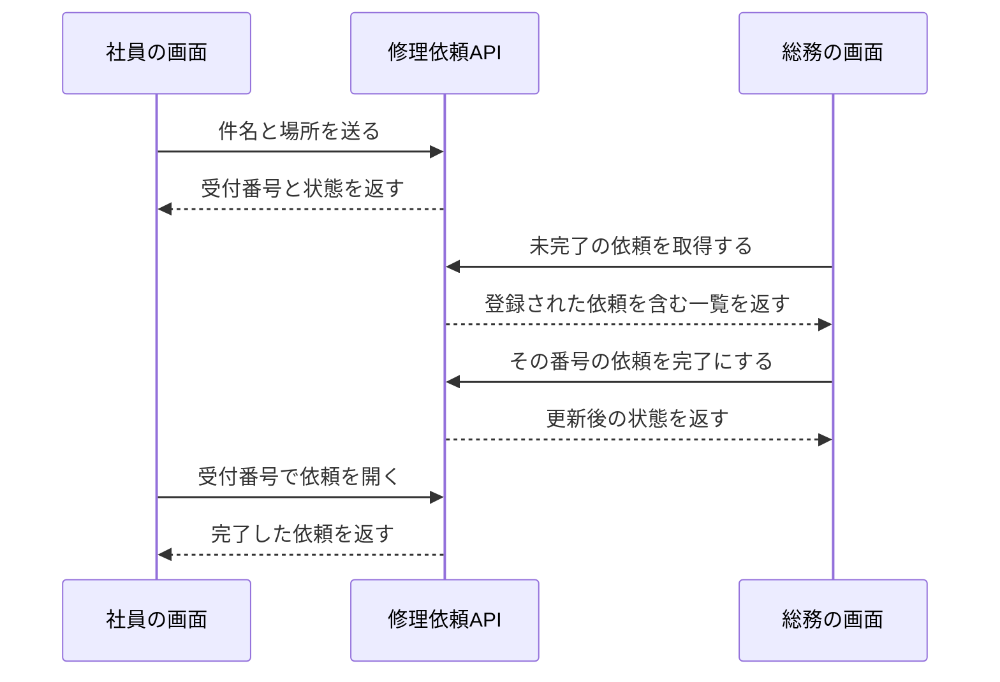

# 第1章　API とは何か

第2会議室の椅子がぐらついています。社員はその場で修理を頼み、席を離れる前に依頼が届いたと確かめたいと考えています。総務には、場所と不具合を確認し、修理が済んだら「完了」と記録できる台帳が必要です。二人が同じ記録を使えるように、修理依頼の受付を作ります。

## API とは、プログラムから機能を使うための取り決め

**API（Application Programming Interface）** は、あるソフトウェアの機能をプログラムから使うための取り決めです。呼び出せる機能、渡す値、受け取る結果を定めます。同じプログラムの中にも API はあります。たとえば Python の `calendar.isleap(2024)` は、年を渡すと、うるう年かどうかを `True` または `False` で答えます。

修理依頼では、離れた端末からサービスにリクエストを送る **Web API** を使います。**クライアント**がリクエスト（要求）を送り、**サーバー**が処理した結果をレスポンス（応答）として返します。両者は **HTTP** という通信の取り決めを使い、件名や場所を **JSON** というテキスト形式で渡します。たとえば `{"title":"椅子がぐらつく","location":"第2会議室"}` は、二つの項目の名前と値を組にしたデータです。

## 同じ依頼を、受付番号で開く

**サンプルで試せる**　社員と総務の画面を思い浮かべながら、手元ではブラウザーの操作画面（Swagger UI）やコマンドで、登録・照会・完了への変更を試せます。AWS に置いたときは、入口で AWS の権限管理の仕組み（IAM）を使います。署名なしのリクエストを拒み、呼び出しを許された相手の署名付きリクエストを通すことを確かめます。社員ごとのログイン画面や、総務だけが完了にできる仕組みは、このサンプルの範囲外です。

総務が一覧から開くのは、社員が登録したその依頼です。件名や場所を台帳に転記する手間が省けます。

同じ取り決めは、社内ポータルに進み具合を表示するときにも使えます。受付番号、状態の意味、結果の返し方が保たれていれば、受付側が保存先を変えても各画面からの呼び出し方は変わりません。

## ファイルで渡すと何が変わるか

**設計例（未実装）**　支店の修理依頼を本部が翌朝まとめて処理するなら、1件を1行にした CSV ファイルを夕方に渡す方法もあります。CSV は項目をカンマで区切るテキスト形式です。件名や場所のほか、次の違いを考えてみましょう。

| 決めること | 夕方に渡す CSV | 依頼のたびに呼ぶ HTTP API |
| --- | --- | --- |
| 何を一度に渡すか | 1日分を1ファイルにまとめる | 依頼1件を一度のリクエストで送る |
| いつ結果が分かるか | 取り込み後に、受理件数とエラー行を結果表で返す | 登録したら、そのレスポンスで受付番号を返す |
| 失敗後にどう確かめるか | ファイル名と行ごとの管理番号で、処理済みの依頼を照合する | レスポンスが途切れると登録結果は不明になる。同じ依頼を二重に作らない再送方法を決める |

ファイルを到着直後に処理したり、API で複数件をまとめたりする設計もできます。選ぶ基準は、**誰が、いつ、どの単位で結果を必要とするか**です。

## この章で決めたこと

- 社員がその場で受付を確認できるよう、修理依頼は Web API で1件ずつ登録する。
- 社員は件名と場所を送り、受付番号を受け取る。
- 社員があとで状況を確かめ、総務が修理完了を記録するときは、同じ番号で依頼を開く。

## 根拠と参考

- API と HTTP の基本：[MDN「API」](https://developer.mozilla.org/ja/docs/Glossary/API)・[Python「calendar.isleap」](https://docs.python.org/ja/3/library/calendar.html#calendar.isleap)・[RFC 9110 §3.3–3.4](https://www.rfc-editor.org/rfc/rfc9110.html#section-3.3)・[RFC 8259 §4 JSON のオブジェクト](https://www.rfc-editor.org/rfc/rfc8259.html#section-4)
- 画面と保存先の役割分担、ファイルでの連携：[Fielding §5.1.2](https://ics.uci.edu/~fielding/pubs/dissertation/rest_arch_style.htm#sec_5_1_2)・[Hohpe・Woolf『Enterprise Integration Patterns』File Transfer](https://www.enterpriseintegrationpatterns.com/patterns/messaging/FileTransferIntegration.html)・[RFC 4180 §2 CSV の書式](https://www.rfc-editor.org/rfc/rfc4180.html#section-2)
- 手元で試せる操作と AWS での確認：[修理依頼の実装・テストガイド](../package/app/README.md)・[AWS「HTTP API の IAM 認可」](https://docs.aws.amazon.com/apigateway/latest/developerguide/http-api-access-control-iam.html)・[配信後の確認コード](../package/infra/post_deploy.py)

[目次](../README.md) ｜ [次へ　第2章　REST とリソース](02-rest.md)
