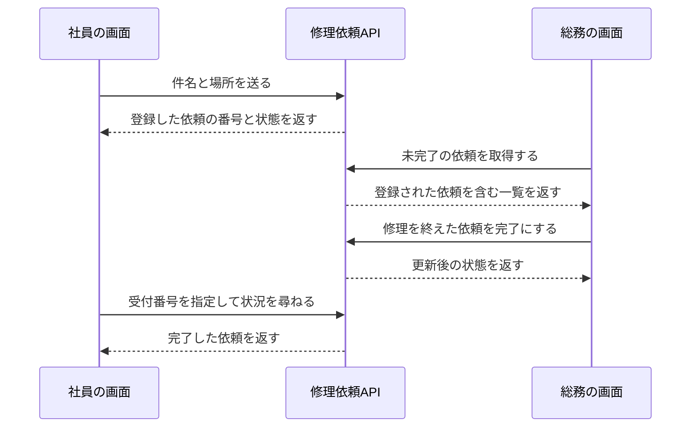

# 第1章　API とは何か

会議室の椅子の脚がぐらついています。社員はスマートフォンから修理を頼み、総務はパソコンでその依頼を開きます。社員が入力した内容を総務がそのまま読めるようにするには、二つの画面の間で何を決めておけばよいでしょうか。

## API は、プログラムから機能を使うための取り決め

**API（Application Programming Interface）** は、あるソフトウェアの機能をプログラムから使うための取り決めです。何を呼び出せるか、何を渡すか、どんな結果が返るかを定めます。[MDN 用語集「API」](https://developer.mozilla.org/ja/docs/Glossary/API)

同じプログラムの中にも API はあります。たとえば Python の `calendar.isleap` は、年を渡すとうるう年かどうかを返す関数です。`calendar.isleap(2024)` の答えは `True`（うるう年）です。呼び出す側は、年の判定方法を一から作らずに、この結果を使えます。[Python 公式ドキュメント「calendar.isleap」](https://docs.python.org/ja/3/library/calendar.html#calendar.isleap)

この教材で扱うのは、ネットワーク越しにサービスの機能を使う **Web API** です。通信には **HTTP** を使います。画面側のプログラム（クライアント）が要求を送り、受付側のプログラム（サーバー）が応答を返します。修理依頼なら、「社員が件名と場所を送ると、受付側は依頼を登録し、受付番号を返す」と約束できます。[AWS「API とは」](https://aws.amazon.com/jp/what-is/api/)・[RFC 9110 §3.3–3.4 クライアント、サーバーとメッセージ](https://www.rfc-editor.org/rfc/rfc9110.html#section-3.3)

## 受付を API で共有すると、何が楽になるか

社員は受付番号を見て、その場で登録できたと分かります。総務が一覧で開くのは、社員が入力したその依頼です。件名や場所を台帳に転記する手間が省けます。修理後に総務が状態を「完了」にすると、社員は受付番号で問い合わせて結果を確かめられます。

同じ取り決めは別のアプリでも使えます。たとえば社内ポータルに依頼の進み具合を表示したくなったら、受付番号を指定して状況を読む機能をそこからも呼び出せます。件名や番号の意味、結果の返し方が保たれていれば、受付側がデータの保存先を変更しても、各画面は同じ方法で依頼を扱えます。[Fielding 第5章 §5.1.2 クライアントとサーバーの役割分担](https://ics.uci.edu/~fielding/pubs/dissertation/rest_arch_style.htm#sec_5_1_2)

## ファイルで渡す場合は何が変わるか

各支店の依頼を本部で翌朝まとめて処理するなら、CSV ファイルで渡す方法もあります。依頼1件を1行にし、行の中の項目をカンマで区切ります。この場合は、列の意味に加えて、受け渡す時刻や、取り込み結果を支店へ知らせる方法も決めます。[RFC 4180 §2 CSV の書式](https://www.rfc-editor.org/rfc/rfc4180.html#section-2)・[Hohpe・Woolf『Enterprise Integration Patterns』File Transfer](https://www.enterpriseintegrationpatterns.com/patterns/messaging/FileTransferIntegration.html)

| 業務で考えること | 夕方にまとめて渡す CSV の例 | 依頼のたびに呼ぶ HTTP API の例 |
| --- | --- | --- |
| 受け渡しの単位 | 1日分を1ファイルにまとめる | 依頼1件を一度の要求で送る |
| 結果が分かる時点 | 本部が取り込んだ後、結果表で受理件数とエラー行を返す | 登録できたかをその場の応答で伝える |
| 失敗したときの手掛かり | ファイル名と行ごとの管理番号で受理済みの依頼を照合する | 応答が届かなければ登録結果が不明になる。再送の扱いを決めておく |

今回の社員は、席を離れる前に自分の依頼が受け付けられたかを知りたいので、1件ずつ登録して応答を返す方法が合います。月末に全件を集計する仕事なら、まとめて受け取れるファイルが扱いやすいでしょう。ファイルの到着と同時に処理することも、API で複数件を渡すこともできます。選ぶ手掛かりは、**誰が、いつ、どの単位で結果を必要とするか**です。

## ここから自分の API を設計するには

「受付番号で後から同じ依頼を開きたい」という希望から、修理依頼1件に番号が必要だと分かります。みなさんの業務では、何を後から探したり、変更したりするでしょうか。第2章からは、その対象に名前を付け、宛先と操作を決め、結果を返すところまでを順に設計します。第7章で設計を仕様書にし、第8・9章で修理依頼の実装例を読みます。

[目次](../README.md) ・ [次へ　REST とリソース](02-rest.md)
