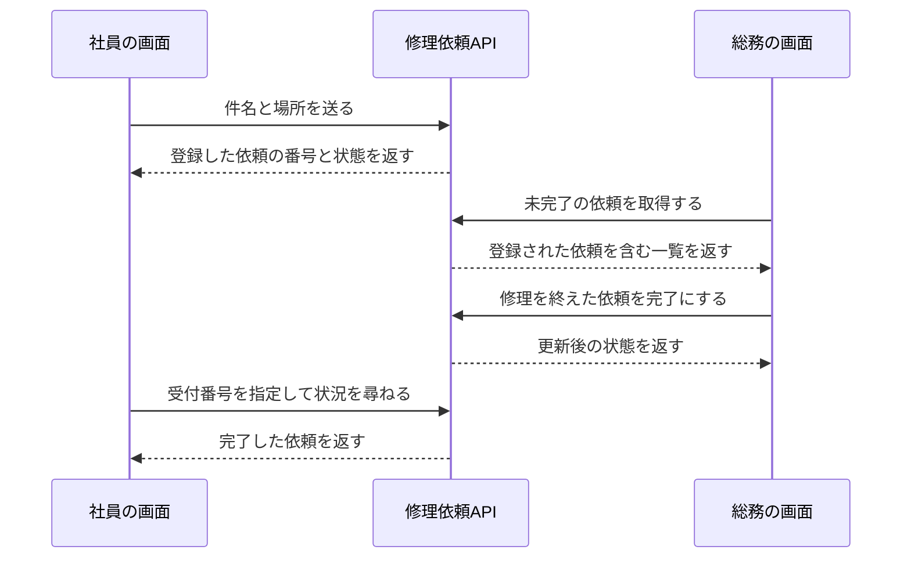

# 第1章　API とは何か

会議室の椅子の脚がぐらついています。社員が修理を依頼すると、その場で受付番号が表示されます。総務の担当者が修理を終えると、社員の画面でも「完了」と確認できます。二つの画面は、どのように同じ依頼を扱っているのでしょうか。

## 画面の裏で何を約束するか

**API（Application Programming Interface）** は、あるプログラムの機能を別のプログラムから使うための取り決めです。たとえば、社員の画面を作る人と、依頼を保存するシステムを作る人が別々でも、「件名と場所を渡せば、登録した依頼の番号が返る」と決めておけば、それぞれの担当が作業を進められます。[AWS「API とは」](https://aws.amazon.com/jp/what-is/api/)

この教材では、ネットワーク越しのやり取りに **HTTP** を使います。画面側のプログラム（クライアント）が要求を送り、受付側のプログラム（サーバー）が応答を返す仕組みです。たとえば、件名「椅子の脚がぐらつく」と場所「第1会議室」を送ると、サーバーは修理依頼を保存し、受付番号を返します。ここで完了したのは依頼の登録です。実際の修理はこれから始まります。[RFC 9110 §3.3 クライアントとサーバー、§3.4 メッセージ](https://www.rfc-editor.org/rfc/rfc9110.html#section-3.3)

この図から設計に必要な問いを三つ拾えます。「利用者は何をしたいか」「何を渡せばよいか」「何が返れば次に進めるか」。最初の往復なら、答えは「修理を依頼したい」「件名と場所を渡す」「受付番号を得たら、後で進み具合を確認できる」です。

## ファイルで渡す場合は何が変わるか

修理依頼は CSV ファイルでも渡せます。依頼1件を1行にまとめ、行の中の項目をカンマで区切ります。たとえば、各支店がその日の依頼をまとめて夕方に送り、本部が翌朝読み込む運用です。ファイル連携を設計するときは、列の意味に加え、受け渡す時刻や、読み込み結果の伝え方も両者で決めます。[RFC 4180 §2 CSV の書式](https://www.rfc-editor.org/rfc/rfc4180.html#section-2)・[Hohpe・Woolf『Enterprise Integration Patterns』File Transfer](https://www.enterpriseintegrationpatterns.com/patterns/messaging/FileTransferIntegration.html)

| 業務で考えること | 夕方にまとめて渡す CSV の例 | 依頼のたびに呼ぶ HTTP API の例 |
| --- | --- | --- |
| 受け渡しの単位 | 1日分を1ファイルにまとめる | 依頼1件を一度の要求で送る |
| 結果が分かる時点 | 本部が取り込んだ後、結果表で受理件数とエラー行を返す | 登録できたかをその場の応答で伝える |
| 失敗したときの手掛かり | ファイル名と行ごとの管理番号で受理済みの依頼を照合する | 応答が届かなければ登録結果が不明になる。再送の扱いを決めておく |

月末の集計なら、対象月の全件を一度に渡せるファイルが扱いやすいでしょう。一方、椅子の修理を頼んだ社員は、席を離れる前に受付番号を知りたいはずです。そこで今回は、1件ずつ登録して結果を返す API を選びます。ファイルを届き次第取り込む運用や、API で複数件を受け付ける設計もあります。選ぶ手掛かりは、**誰が、いつ、どの単位で結果を必要とするか**です。

## ここから自分の API を設計するには

修理依頼では「受付番号で後から同じ依頼を開きたい」という希望から、依頼1件に番号が必要だと分かりました。別の業務でも、まず「利用者は何を後から探したり、変更したりするか」を一つ挙げてみてください。第2章からは、その対象に名前を付け、宛先と操作を決め、結果を返すところまでを順に設計します。第7章で設計を仕様書にし、第8・9章で修理依頼の実装例を読みます。

[目次](../README.md) ・ [次へ　REST とリソース](02-rest.md)
