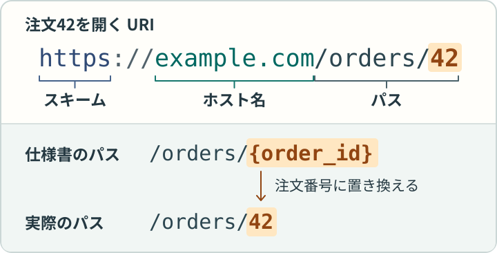

# 第3章　パスとパラメータ

「注文42を開く」の **42** と、「未発送の注文を10件見る」の **10** は、どちらも数値です。42を替えると、別の注文を開きます。10を替えると、一度に表示する件数が変わります。API の入力を設計するときは、それぞれの値を替えると何が変わるかを考えます。

## 業務の言葉からパスを組み立てる

HTTP では、**URI（Uniform Resource Identifier）** で対象を識別します。図の `https` は通信方式を示すスキーム、`example.com` は接続先のホスト名です。その後の `/orders/42` を **パス** と呼びます。[RFC 3986 §3 URI の構成](https://www.rfc-editor.org/rfc/rfc3986.html#section-3)



パスを決めるときは、利用者の言葉を次の順に読み解きます。

1. **扱う対象に名前を付ける。** 「注文を開く」なら、対象は「注文」です。取得という操作は HTTP メソッドの `GET` で表せるので、パスの名前には名詞の `orders` を使います。同じ注文を更新するときも、この名前が使えます。
2. **集合と1件を分ける。** `/orders` は注文の集まりです。1件を指すときは番号を足し、仕様書には `/orders/{order_id}` と書きます。波かっこの中は実際の値に置き換える部分で、これが **パスパラメータ** です。送るパスは注文42なら `/orders/42`、注文57なら `/orders/57` になります。
3. **親の番号が必要なときに階層を足す。** 同じ「明細3」が注文ごとにあるなら、`/orders/42/lines/3` で特定できます。一方、荷物を配送番号だけで特定できるなら、`/shipments/S7` を直接開けます。注文からその荷物を探せるようにするには、注文の応答に荷物のリンクを載せる方法があります。

集合を複数形にすると、名前から「注文の集まり」と分かります。修理依頼の `/repair-requests` のように、固定の英単語は小文字でそろえ、単語の境目をハイフンで示すと、読み手が綴りを予測しやすくなります。これは教材で選ぶ**命名規約**です。RFC 3986 は URI の構文を定めます。集合名の単数・複数や英単語の区切り方は、API ごとに決められます。[RFC 3986 §3.3](https://www.rfc-editor.org/rfc/rfc3986.html#section-3.3)・[Zalando のパス命名規約](https://opensource.zalando.com/restful-api-guidelines/#129)・[Microsoft のリソース設計指針](https://learn.microsoft.com/en-us/azure/architecture/best-practices/api-design#define-restful-web-api-resource-uris)・[OpenAPI のパスの書き方](https://spec.openapis.org/oas/v3.1.1.html#path-templating)

**動詞を付けたくなったら、操作後に何をたどりたいか**を考えてみてください。「注文を取り消す」だけなら、注文の状態を変更する方法があります。取消理由や承認結果を後から読むなら、`/orders/42/cancellation-requests` に取消申請を登録するほうが、経過を追いやすくなります。標準の操作では固有の手続きを表しにくい場合に、独自の操作名を許す設計指針もあります。たとえば Google は、その場合の表記として `:archive` のような接尾辞を定めています。[Google AIP-136 Custom methods](https://google.aip.dev/136#guidance)

階層は、利用者が知っている番号で目的の対象を指せるところまでにします。HTTP には「3階層まで」といった決まりも、URI の長さの一律の上限もありません。RFC 9110 の **8,000オクテット（バイト）** は、送受信する側が少なくともその長さの URI を扱えるようにするための推奨値です。実際に通せる長さはサーバーや中継機器の制限によります。対象の URI が受け付けられる長さを超えた場合の応答は `414 URI Too Long` です。[RFC 9110 §4.1](https://www.rfc-editor.org/rfc/rfc9110.html#section-4.1)・[§15.5.15](https://www.rfc-editor.org/rfc/rfc9110.html#section-15.5.15)

## 入力は、その値を使う目的で分ける

パスとクエリの値は、どちらも URL に含まれます。パスの `/orders/42` のうち、注文を選ぶ値 `42` が **パスパラメータ** です。`?` に続く `limit=10` のような名前と値の組を **クエリパラメータ** と呼びます。URL の外で送るのが、要求に関する追加情報を伝える **リクエストヘッダー** と、データ本体を届ける **リクエストボディ（本文）** です。[RFC 3986 §3.3–3.4](https://www.rfc-editor.org/rfc/rfc3986.html#section-3.3)・[RFC 9110 §6.3–6.4](https://www.rfc-editor.org/rfc/rfc9110.html#section-6.3)

| 置き場所 | 何を入れるとよいか | 何を避けるか、その理由 |
| --- | --- | --- |
| パスパラメータ | 個別の対象を指す番号。例は `/orders/42` の `42` | パスワードや秘密の API キー。URL の一部になり、共有や記録の際に値まで残る |
| クエリパラメータ | 検索条件、順序、件数。例は `?status=unshipped&limit=10` | 秘密のトークンや個人情報。ページを開くと、条件を含んだ URL が閲覧履歴に残り得る |
| リクエストボディ | 登録する注文の明細、変更する値、ログイン時に提出する情報 | GET の一覧検索の条件。GET の本文には HTTP で一般に定義された意味がなく、受信側が解釈するとは限らない |
| リクエストヘッダー | 欲しい応答形式は `Accept`、送る本文の形式は `Content-Type`、Bearer トークンは `Authorization` | 注文明細のような業務データを独自ヘッダーに詰めること。構造を持つデータは本文にまとめると、項目の型や意味を仕様書で表しやすい |

同じ `status` でも、未発送の注文を**探す**ならクエリに、注文42を発送済みに**変える**なら `PATCH /orders/42` の本文に `{"status":"shipped"}` と書きます。[RFC 9110 §9.3.1 GET](https://www.rfc-editor.org/rfc/rfc9110.html#section-9.3.1)・[第4章　操作に合うメソッドを選ぶ](04-methods.md)

### 一覧から1件の詳細を開く

一覧で注文を選び、その詳細を開くまでを比べてみましょう。次は、未発送の注文が1件あるときの要求と応答の例です。

| 画面での操作 | HTTP の要求 | 成功時の応答例 |
| --- | --- | --- |
| 未発送の注文を並べる | `GET /orders?status=unshipped&limit=10` | `200` と `{"items":[{"id":42,"status":"unshipped"}],"next_after":null}` |
| 選んだ注文42の商品と数量を見る | `GET /orders/42` | `200` と `{"id":42,"status":"unshipped","product_id":"P7","quantity":2}` |

一覧は、結果が1件でも `items` の配列を返します。画面はその中の注文番号を取り出し、詳細のパスに使います。詳細は注文1件を表すので、商品や数量を直接読めます。ここでの JSON の形は、この API で決めた契約です。

### 登録時の ID は誰が決めるか

登録要求を組み立てるときは、**これから作る対象の ID** と、**すでにある対象を指す ID** を分けて考えます。商品 P7 を2個注文する例と、既存の注文に明細を足す例を比べましょう。[RFC 9110 §9.3.3 POST](https://www.rfc-editor.org/rfc/rfc9110.html#section-9.3.3)・[§9.3.4 PUT](https://www.rfc-editor.org/rfc/rfc9110.html#section-9.3.4)

| ID の決め方 | 要求と JSON 本文の例 | なぜそこに置くか |
| --- | --- | --- |
| サーバーが新しい注文番号を振る | `POST /orders`　`{"product_id":"P7","quantity":2}` | 本文は既存の商品番号と数量。新しい注文番号は送らず、作成後に `201` と `Location: /orders/42` で知る |
| 注文42に明細を追加し、サーバーが明細番号を振る | `POST /orders/42/lines`　`{"product_id":"P8","quantity":1}` | 親の注文番号はパスにあり、書き直す必要はない。本文の商品番号は何を買うかを指す。新しい明細番号はこれから決まる |
| 呼び出し側が新しい注文番号を決められる別の契約 | `PUT /orders/57`　`{"product_id":"P7","quantity":2,"status":"unshipped"}` | 注文番号をパスで指定し、そこに保存する注文の完成形を本文で渡す |

最後の `PUT` を新規作成だけに使いたいときは、`If-None-Match: *` ヘッダーを添えると、その宛先にすでに注文があれば上書きせず `412 Precondition Failed` が返ります。[RFC 9110 §13.1.2](https://www.rfc-editor.org/rfc/rfc9110.html#section-13.1.2)

パスと本文の両方で同じ対象の ID を受け取る契約なら、不一致の扱いも決めます。たとえば `PUT /orders/42` に本文の `id` が `57` で届いたら、どちらも変更せず `400 Bad Request` を返す、と明記します。ここでの `400` は設計例です。こうした入出力の決め方を業務全体に当てはめる手順は、第6章で扱います。[RFC 9110 §15.5.1](https://www.rfc-editor.org/rfc/rfc9110.html#section-15.5.1)・[第6章　業務を API の契約にする](06-contract.md)

### パスワードとアクセストークンはどこへ送るか

たとえば、自社のログイン画面から自社の認証サービスにパスワードを送る API を設計します。ここでは宛先を `POST /sessions` とし、HTTPS で次の JSON を本文に送ります。ヘッダーには `Content-Type: application/json` を付けます。項目の値は説明用のプレースホルダーです。[RFC 9110 §8.3 Content-Type](https://www.rfc-editor.org/rfc/rfc9110.html#section-8.3)・[OWASP「HTTP 要求に含まれる機密情報」](https://cheatsheetseries.owasp.org/cheatsheets/REST_Security_Cheat_Sheet.html#sensitive-information-in-http-requests)

```json
{"login_id":"<ログインID>","password":"<入力したパスワード>"}
```

ログイン後、アクセスを許されたことを示す **アクセストークン** を使う設計もあります。Bearer 方式なら、以後の API 呼び出しでは `Authorization: Bearer <アクセストークン>` とヘッダーに指定します。**パスワード、秘密のトークン、秘密の API キーは、パスにもクエリにも入れません。** URL はそのまま共有でき、サーバーや中継機器の設定によってアクセスログにも残るためです。[RFC 6750 §2.1](https://www.rfc-editor.org/rfc/rfc6750.html#section-2.1)・[RFC 9700 §4.3.2](https://www.rfc-editor.org/rfc/rfc9700.html#section-4.3.2)・[RFC 9110 §17.9](https://www.rfc-editor.org/rfc/rfc9110.html#section-17.9)

通信中の値を暗号化するのは、HTTPS が使う **TLS** です。ヘッダーや本文に書くこと自体には、暗号化の働きはありません。TLS の接続を受けるサーバーや中継機器は内容を読み取れます。ヘッダーや本文を記録する設定なら、そこにも値が残ります。ログインの本文や認証ヘッダーを丸ごと記録せず、必要な項目だけをログに残します。[RFC 8446 §1 TLS の役割](https://www.rfc-editor.org/rfc/rfc8446.html#section-1)・[OWASP「ログから除外するデータ」](https://cheatsheetseries.owasp.org/cheatsheets/Logging_Cheat_Sheet.html#data-to-exclude)

ログイン後に自分の情報を読む `GET /me` の例は、第4章で HTTP の要求として読み解きます。[第4章　操作に合うメソッドを選ぶ](04-methods.md)

## 省略・組み合わせ・続きの意味を決める

値の置き場所が同じでも、API ごとに入力の約束は変わります。注文の例なら、次のように仕様書に書けます。

| 入力 | この例で決めたこと |
| --- | --- |
| `order_id` | 正の整数。個別の注文を指定するときに必須 |
| `status` と `customer_id` | 任意。省略した項目では絞り込まない。両方を指定したら両方に一致する注文を返す |
| `limit` | 1〜100の整数。省略時は20件。範囲外は入力エラー |
| `after` | 注文番号の昇順で続きを読む位置。最初は省略し、次のページでは応答で得た位置と同じ絞り込み条件を指定する |

複数の値を受け付けるなら、記法と意味を対にします。たとえば `status=shipped&status=delivered` を「発送済み**または**配達済み」と定めます。OpenAPI では、パスやクエリの値は `parameters`、複数値の書き方は `style` と `explode`、本文は `requestBody` に記述できます。パスパラメータは必須です。[OpenAPI 3.1.1 Parameter Object](https://spec.openapis.org/oas/v3.1.1.html#parameter-object)・[Style Examples](https://spec.openapis.org/oas/v3.1.1.html#style-examples)・[Request Body Object](https://spec.openapis.org/oas/v3.1.1.html#request-body-object)

値自体に区切り文字が入ることもあります。検索語 `R&D` を渡すなら、`&` を区切りと区別するため、送るクエリは `?q=R%26D` になります。HTTP ライブラリにクエリの値を渡すときは、元の `R&D` を渡し、符号化を一度だけ任せます。[RFC 3986 §2.4](https://www.rfc-editor.org/rfc/rfc3986.html#section-2.4)

[前へ　REST とリソース](02-rest.md) ・ [目次](../README.md) ・ [次へ　メソッドと再送](04-methods.md)
