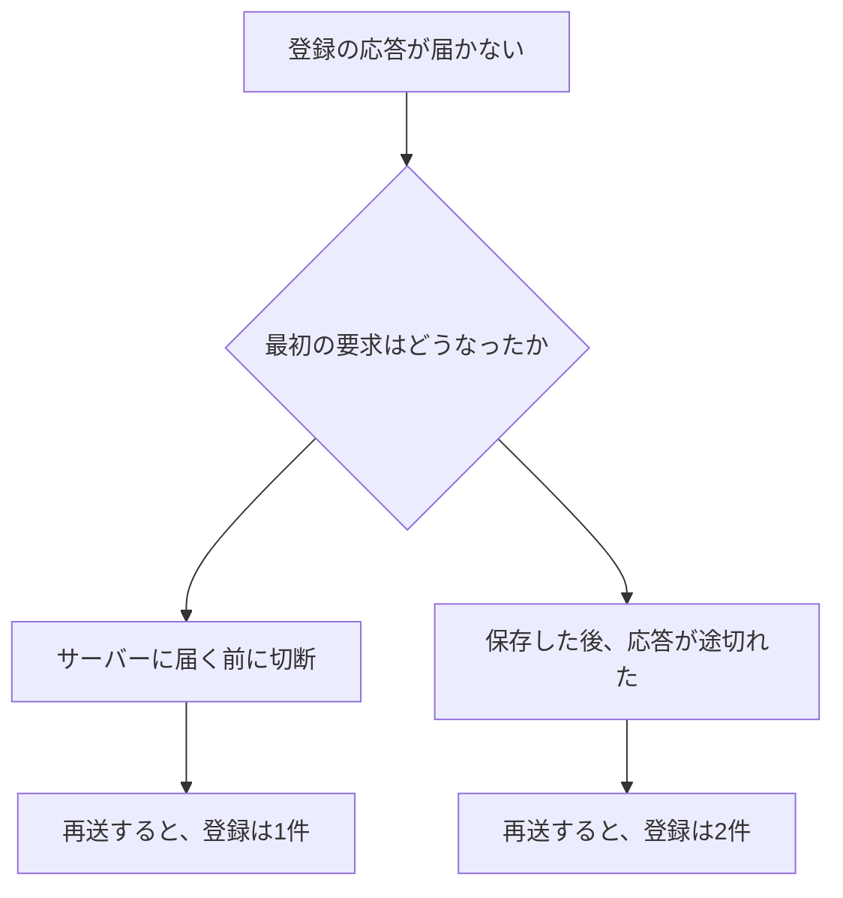

# 第4章　操作に合うメソッドを選ぶ

API の宛先を決めたら、「この要求が成功すると、利用者にとって何が変わるか」を一文で書いてみましょう。「現在の設定が分かる」「設定が指定した内容に変わる」「承認の記録が1件増える」。この違いを表すのが **HTTP メソッド**です。[RFC 9110 §9.1 メソッドの役割](https://www.rfc-editor.org/rfc/rfc9110.html#section-9.1)

## 読む、置き換える、変更を頼む

読みたいものが一つでも一覧でも、取得には `GET` を使います。変更が必要なら、次に「対象の宛先はすでに決まっているか」「送るのは完成形か、変更の指示か」を考えます。

| 成功したときに期待すること | メソッドとパスの例 | 成功時の応答例 |
| --- | --- | --- |
| 指定した予約の内容が分かる | `GET /reservations/48` | `200` と予約内容。一覧も同じ考え方で `GET /reservations` と書ける |
| 予約が1件増え、サーバーが予約番号を決める | `POST /rooms/3/reservations` | `201` と、新しい宛先を示す `Location: /reservations/48` |
| 店舗の営業時間表が、送った完成形に置き換わる | `PUT /stores/3/business-hours` | 初めて作れば `201`。既存の表を置き換えたら、表を返す場合は `200`、本文を返さなければ `204` |
| 営業時間表のうち、指定した曜日だけが変わる | `PATCH /stores/3/business-hours` | `200` と変更後の表。更新だけを知らせる設計なら `204` |
| 誤登録した予約を取り除く | `DELETE /reservations/48` | 削除を終え、本文を返さなければ `204` |

作成にも `POST` と `PUT` の両方が使えます。たとえば、店舗コードから営業時間表の宛先が初めから分かるなら、そこへ `PUT` して最初の表を置けます。同じ宛先に表がすでにあれば置き換えです。`DELETE` で何を監査記録に残すかは、保存期間とあわせて業務側で決めます。[RFC 9110 §9.3.1 GET](https://www.rfc-editor.org/rfc/rfc9110.html#section-9.3.1)・[§9.3.3 POST](https://www.rfc-editor.org/rfc/rfc9110.html#section-9.3.3)・[§9.3.4 PUT](https://www.rfc-editor.org/rfc/rfc9110.html#section-9.3.4)・[§9.3.5 DELETE](https://www.rfc-editor.org/rfc/rfc9110.html#section-9.3.5)

本文を受け取らず、更新日時などのヘッダーを確かめたいときには `HEAD` が使えます。また、対象で利用できる通信上の選択肢を問い合わせるメソッドが `OPTIONS` です。[RFC 9110 §9.3.2 HEAD](https://www.rfc-editor.org/rfc/rfc9110.html#section-9.3.2)・[§9.3.7 OPTIONS](https://www.rfc-editor.org/rfc/rfc9110.html#section-9.3.7)

### 同じボタンでも、残したい記録で設計が変わる

たとえば「承認する」というボタンがあるとします。目的が申請の現在の状態を変えることなら、`PATCH /applications/17` で新しい状態を指定できます。一方、誰がいつ承認したかを一件ずつ追う必要があるなら、承認記録にも番号を付けられます。その設計では `POST /applications/17/approvals` で記録を作り、あとから参照します。ボタン名は同じでも、次に読み出したいものが違います。

`POST` の一般的な意味は、送った内容に対して、その宛先で定めた処理を頼むことです。`PATCH` には、どう変更するかを本文に書きます。たとえば本教材の修理依頼では、`PATCH /repair-requests/42` に `{"status":"completed"}` を送ると、件名と場所を保ったまま状態が変わります。`application/json` は本文の形式を示します。更新できる項目と値の意味は API の契約に書きます。複数の変更を一度の `PATCH` で受け付けるなら、すべてをまとめて反映します。[RFC 9110 §9.3.3](https://www.rfc-editor.org/rfc/rfc9110.html#section-9.3.3)・[RFC 5789 §2 PATCH](https://www.rfc-editor.org/rfc/rfc5789.html#section-2)

## 同じ要求を二度送るとどうなるか

「結果が分からない」と「失敗した」は違います。登録ボタンを押した直後に通信が切れた場面を考えてみましょう。次の図は、再送すると新規登録が成功する場合の例です。

この判断には、HTTP の二つの性質が役立ちます。**安全（safe）** は、利用者が状態の変更を求めないことです。`GET` で閲覧ログが増えても、利用者の目的は読み取りです。**冪等（べきとう、idempotent）** は、同じ要求を繰り返しても、意図した効果が1回分と同じことです。`GET`、`PUT`、`DELETE` は冪等です。削除の1回目が `204`、2回目が `404` でも、対象を取り除くという効果は同じです。[RFC 9110 §9.2.1–2](https://www.rfc-editor.org/rfc/rfc9110.html#section-9.2.1)

`POST` と `PATCH` の再送は、個々の API の取り決めを確かめます。「状態を完了にする」操作を続けて2回送っても最終値は同じですが、「数量を1増やす」操作では数量が2増えます。自動再送が必要な登録では、呼び出し側が操作ごとに一意のキーを作る方法があります。サーバーは利用者・キー・処理結果を登録と一緒に保存し、同じ操作が届けば前の結果を返します。キーを覚えておく期間と、同じキーで別の内容が届いた場合の扱いも契約に含めます。[RFC 9110 §9.2.2](https://www.rfc-editor.org/rfc/rfc9110.html#section-9.2.2)・[Amazon Builders’ Library「Making retries safe with idempotent APIs」](https://aws.amazon.com/builders-library/making-retries-safe-with-idempotent-APIs/)

修理依頼サンプルの新規登録は、呼ぶたびに別の番号を振ります。応答が届かなければ、まず一覧を開いて受付済みの依頼を確認する、という使い方ができます。次の章では、結果が届いたとき、利用者がそこから何を判断できるかを考えます。

[前へ　パスとパラメータ](03-addresses.md) · [目次](../README.md) · [次へ　応答とエラー](05-responses.md)
