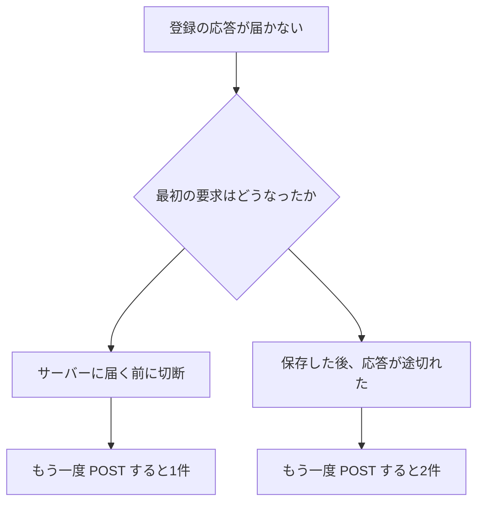

# 第4章　操作に合うメソッドを選ぶ

総務の担当者が修理依頼の詳細を開き、椅子を直したら「完了」を押します。どちらも同じ依頼を扱いますが、詳細を何度開いても、依頼の状態は変わらないはずです。この違いをサーバーに伝えるのが **HTTP メソッド**です。[RFC 9110 §9.1](https://www.rfc-editor.org/rfc/rfc9110.html#section-9.1)

## 画面の動作を要求に置き換える

ここでは、サーバーが新しい依頼に番号を振ります。社員が登録するときは、まだ依頼番号を知りません。そこで依頼の集まりに `POST` します。番号が分かれば、その依頼を示すパスに対して照会や更新ができます。[RFC 9110 §9.3.3–4](https://www.rfc-editor.org/rfc/rfc9110.html#section-9.3.3)

| したいこと | サンプルで送る要求 | 成功すると |
| --- | --- | --- |
| 新しい依頼を登録する | `POST /repair-requests` | `201` と、新しい依頼の場所が返る |
| 未完了の依頼を探す | `GET /repair-requests?status=open` | `200` と、条件に合った依頼の一覧が返る |
| 依頼42を開く | `GET /repair-requests/42` | `200` と、依頼42の内容が返る |
| 依頼42の状態を変える | `PATCH /repair-requests/42` | `200` と、変更後の内容が返る |
| 誤って登録した依頼42を削除する | `DELETE /repair-requests/42` | 本文のない `204` が返る |

読み取りには `HEAD` という選択肢もあります。`GET` と同じ対象について、本文を送らずにヘッダーを返すメソッドです。`OPTIONS` は、対象で利用できる通信上の選択肢を問い合わせます。修理依頼で画面に必要な操作は上の5つです。[RFC 9110 §9.3.2 HEAD](https://www.rfc-editor.org/rfc/rfc9110.html#section-9.3.2)・[§9.3.7 OPTIONS](https://www.rfc-editor.org/rfc/rfc9110.html#section-9.3.7)

### 状態だけを変えるとき

担当者が「完了」を押したとき、件名と場所はそのまま残します。この API が受け取る変更指示は次のとおりです。

```http
PATCH /repair-requests/42 HTTP/1.1
Host: api.example.com
Content-Type: application/json
Content-Length: 22

{"status":"completed"}
```

`PATCH` の本文は、対象に加える変更を表します。ここでは `status` を指定値にする、という約束を設けました。`application/json` が伝えるのは本文の形式までです。どの項目をどう変えられるかは API の仕様に書きます。一度の要求で複数の変更を受け付ける設計なら、すべて成功したときだけまとめて反映します。[RFC 5789 §2](https://www.rfc-editor.org/rfc/rfc5789.html#section-2)

利用者が既知の URI に完成形を送り、その内容で対象を作成または置き換える設計には `PUT` が向きます。たとえば、会議室ごとに案内文を一つ持ち、全文を入稿する操作です。修理依頼のサンプルで提供する更新は、前述の `PATCH` です。[RFC 9110 §9.3.4](https://www.rfc-editor.org/rfc/rfc9110.html#section-9.3.4)

## 応答が届かなかったら、もう一度送ってよいか

社員が「登録」を押した直後、通信が切れました。画面に受付番号が出なくても、サーバーではすでに依頼を保存したかもしれません。同じ `POST` を自動で送り直すと、椅子1脚の修理が2件登録されるおそれがあります。[RFC 9110 §9.2.2](https://www.rfc-editor.org/rfc/rfc9110.html#section-9.2.2)



画面からはどちらの経路か分かりません。この API を使う画面なら、自動再送を控え、社員に依頼の一覧を案内できます。社員は件名と場所を手掛かりに、受付済みかを確かめます。同じ内容の依頼が複数あって区別できないときは、受付の担当者に確認します。

再送を考えるとき、HTTP の用語が二つ役立ちます。

| 性質 | 判断するための問い | 修理依頼での例 |
| --- | --- | --- |
| 安全（safe） | 利用者が求めているのは読み取りだけか | `GET` で依頼を開く。閲覧ログが増えても、依頼を変更する意図はない |
| 冪等（べきとう、idempotent） | 同じ要求を繰り返しても、利用者が求めた効果は1回分と同じか | `DELETE` を2回送っても、対象の依頼は削除された状態になる |

`GET` は安全かつ冪等です。`PUT` と `DELETE` は対象を変えますが、冪等です。1回目の削除が `204`、2回目が `404` でも、この性質は変わりません。`POST` と `PATCH` については、メソッド名だけでは再送の可否を判断できません。今回の「状態を完了にする」は同じ値を設定する操作ですが、「修理回数を1増やす」なら再送のたびに値が変わります。[RFC 9110 §9.2.1–2](https://www.rfc-editor.org/rfc/rfc9110.html#section-9.2.1)・[RFC 5789 §2](https://www.rfc-editor.org/rfc/rfc5789.html#section-2)

登録の自動再送が業務上必要なら、別の設計もあります。たとえば画面が登録操作ごとに一意な受付キーを作り、再送には同じキーを使います。サーバーは「誰の、どのキーか」と依頼を一緒に保存し、同じ要求には前回の受付結果を返します。この方式を採用するときは、キーの有効期間や、同じキーで別の内容が届いた場合の扱いも決めます。[Amazon Builders’ Library「Making retries safe with idempotent APIs」](https://aws.amazon.com/builders-library/making-retries-safe-with-idempotent-APIs/)

メソッドを決めると、サーバーに何を頼むかが定まります。次は、その結果を見た画面がどう動けばよいかを考えます。

[前へ　パスとパラメータ](03-addresses.md) · [目次](../README.md) · [次へ　応答とエラー](05-responses.md)
