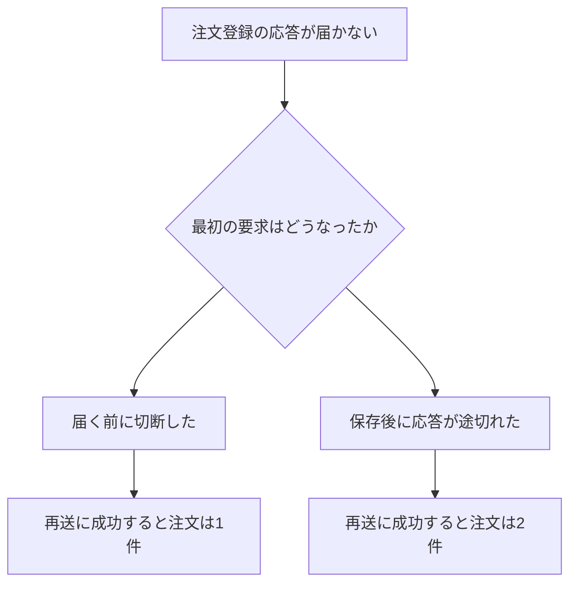

# 第4章　操作に合うメソッドを選ぶ

「注文を表示する」と「注文を登録する」では、利用者が期待する結果が違います。前者なら同じ画面を何度開いても注文数は変わりません。後者なら新しい注文が1件増えます。**HTTP メソッド**は、対象にどのような操作を求めるかを伝えます。まず、成功したときに何が変わるかを一文で書いてみましょう。[RFC 9110 §9.1](https://www.rfc-editor.org/rfc/rfc9110.html#section-9.1)

## 注文 API で五つのメソッドを選ぶ

下の表は注文 API の設計例です。個別の注文は番号で開けます。注文ごとに一つ持つ配送指示には、受取場所と備考を登録できます。

| どんなとき | メソッドとパス | 送る値 | 主な成功応答 |
| --- | --- | --- | --- |
| 注文を1件開く | `GET /orders/42` | パスに注文番号 `42`。本文は使わない | `200 OK` と注文内容 |
| 新しい注文を登録し、番号を振ってもらう | `POST /orders` | 本文に `{"product_id":"P7","quantity":2}` | `201 Created`。新しい宛先を `Location` で知らせる |
| 配送指示の完成形を保存する | `PUT /orders/42/delivery-instructions` | パスに注文番号。本文に全項目 `{"place":"受付","note":"平日のみ"}` | 初めて作れば `201`。置き換えたら、結果を返す場合は `200`、本文を省く場合は `204` |
| 配送指示の備考だけを変える | `PATCH /orders/42/delivery-instructions` | パスに注文番号。本文に `{"note":"午前中"}` | この例では `200` と変更後の配送指示。受取場所は「受付」のまま |
| 誤登録した下書きの注文を削除する | `DELETE /orders/42` | パスに削除する注文番号。本文は使わない | 削除を終え、本文を返さなければ `204 No Content` |

選ぶ手掛かりの一つは、**新しく作るものの宛先を誰が決めるか**です。注文番号はサーバーが決めるので、登録先は集合の `/orders` です。一方、注文42の配送指示の宛先は最初から分かっています。そこに完成形を置くなら、初回も更新時も `PUT` を使えます。[RFC 9110 §9.3.3 POST](https://www.rfc-editor.org/rfc/rfc9110.html#section-9.3.3)・[§9.3.4 PUT](https://www.rfc-editor.org/rfc/rfc9110.html#section-9.3.4)

`PATCH` の本文は変更の指示です。「指定した項目をこの値にし、他の項目は保つ」というのは上の API が定めた約束です。JSON を採用するだけでは、省略された項目の扱いも、変更できる項目も決まりません。使う形式と操作の意味を契約に書きます。一度の `PATCH` が複数の変更を含む場合は、全部をまとめて適用し、一部だけ成功した状態を残しません。[RFC 5789 §2](https://www.rfc-editor.org/rfc/rfc5789.html#section-2)

業務で履歴が必要なら、残したい出来事もリソースの候補です。第3章の「注文を取り消す」例では、`POST /orders/42/cancellation-requests` で取消申請を登録すると、あとで理由や承認結果を読めます。`POST` は、その宛先で定めた処理を頼むメソッドです。新しい記録の作成はその一例です。[RFC 9110 §9.3.3](https://www.rfc-editor.org/rfc/rfc9110.html#section-9.3.3)

## リクエストとレスポンスを1往復読む

表の `POST /orders` を、通信で見るとどうなるでしょうか。下は HTTP/1.1 の読み方を示す抜粋です。最初の行に続いてヘッダーが並び、空行の後に本文が来ます。例の `Content-Length` は本文のバイト数です。[RFC 9112 §2.1 メッセージの形式](https://www.rfc-editor.org/rfc/rfc9112.html#section-2.1)

**クライアントからの要求（リクエスト）**。最初の行では `POST` が操作、`/orders` が宛先です。`Host` は送信先のホスト名を伝えます。本文で「商品 P7 を2個」と指定しています。

```http
POST /orders HTTP/1.1
Host: example.com
Content-Type: application/json
Accept: application/json
Content-Length: 32

{"product_id":"P7","quantity":2}
```

**サーバーからの応答（レスポンス）**。最初の行の `201` は登録成功を示します。サーバーが付けた注文番号は `42` です。次にこの注文を開くときは、`Location` の宛先に `GET` を送れます。[RFC 9110 §15.3.2](https://www.rfc-editor.org/rfc/rfc9110.html#section-15.3.2)

```http
HTTP/1.1 201 Created
Location: /orders/42
Content-Type: application/json
Content-Length: 40

{"id":42,"product_id":"P7","quantity":2}
```

### ヘッダーは誰が、何を伝えるものか

| ヘッダー | この用途での方向 | 伝えること |
| --- | --- | --- |
| `Content-Type` | 要求・応答の両方 | 今送る本文の形式。上の例では両方向とも JSON |
| `Accept` | 要求 | クライアントが受け取りたい応答の形式。実際に返った形式は応答の `Content-Type` で確かめる |
| `Authorization` | 要求 | 認証が必要なときに、採用した認証方式に従って資格情報を渡す |
| `Location` | 応答 | `201` では、新しく作成した主なリソースの宛先を知らせる |

`Content-Type` と `Accept` は役割が違います。注文を JSON で送って結果を CSV で受け取りたいなら、要求の `Content-Type` は `application/json`、`Accept` は `text/csv` です。`Accept` は希望を伝える項目です。この教材の修理依頼 API は、成功時に本文を返す操作では JSON を使います。[RFC 9110 §8.3 Content-Type](https://www.rfc-editor.org/rfc/rfc9110.html#section-8.3)・[§12.5.1 Accept](https://www.rfc-editor.org/rfc/rfc9110.html#section-12.5.1)・[§11.6.2 Authorization](https://www.rfc-editor.org/rfc/rfc9110.html#section-11.6.2)・[§10.2.2 Location](https://www.rfc-editor.org/rfc/rfc9110.html#section-10.2.2)

`GET` なら検索条件はクエリに、`DELETE` なら削除したい対象は宛先に置きます。この二つの要求の本文には HTTP で共通に定めた意味がなく、受け取ったサーバーなどが要求を拒む場合もあるためです。本文を受け取らず更新日時などのヘッダーを確かめる用途には `HEAD`、対象で使える通信上の選択肢を問い合わせる用途には `OPTIONS` もあります。[RFC 9110 §9.3.1 GET](https://www.rfc-editor.org/rfc/rfc9110.html#section-9.3.1)・[§9.3.5 DELETE](https://www.rfc-editor.org/rfc/rfc9110.html#section-9.3.5)・[§9.3.2 HEAD](https://www.rfc-editor.org/rfc/rfc9110.html#section-9.3.2)・[§9.3.7 OPTIONS](https://www.rfc-editor.org/rfc/rfc9110.html#section-9.3.7)

## 返事が来なければ、もう一度送ってよいか

注文を送った直後に通信が切れました。画面から見えるのは「応答が届かなかった」ことだけです。サーバーの側では、最初の要求がどこまで進んだかによって結果が分かれます。



**安全（safe）** は、利用者が状態の変更を求めないことです。`GET` で閲覧ログが増えても、利用者が求めたのは読み取りです。**冪等（べきとう、idempotent）** は、同じ要求を繰り返しても意図した効果が1回分と同じことです。`GET`、`PUT`、`DELETE` は冪等です。1回目の削除で `204`、2回目で `404` が返っても、対象を取り除くという効果は同じです。[RFC 9110 §9.2.1–2](https://www.rfc-editor.org/rfc/rfc9110.html#section-9.2.1)

`POST` や `PATCH` の再送は、その操作の契約から判断します。「数量を2にする」なら続けて同じ要求を送っても2です。「数量を1増やす」なら送るたびに増えます。注文登録の自動再送が必要なら、クライアントが登録操作ごとに一意のキーを作り、再送でも同じキーを渡す方法があります。サーバーは利用者・キー・結果を注文と一緒に保存し、同じ操作には前回の注文番号を返します。キーを保つ期間と、同じキーに異なる内容が届いた場合の扱いも契約に含めます。[RFC 9110 §9.2.2](https://www.rfc-editor.org/rfc/rfc9110.html#section-9.2.2)・[Amazon Builders’ Library「Making retries safe with idempotent APIs」](https://aws.amazon.com/builders-library/making-retries-safe-with-idempotent-APIs/)

ここまでで、何を、どのメソッドで送るかが決まりました。次の章では、結果を見た利用者が入力を直す、完成したデータを開く、処理を待つといった行動を選べるように、応答を設計します。

[前へ　パスとパラメータ](03-addresses.md) · [目次](../README.md) · [次へ　応答とエラー](05-responses.md)
