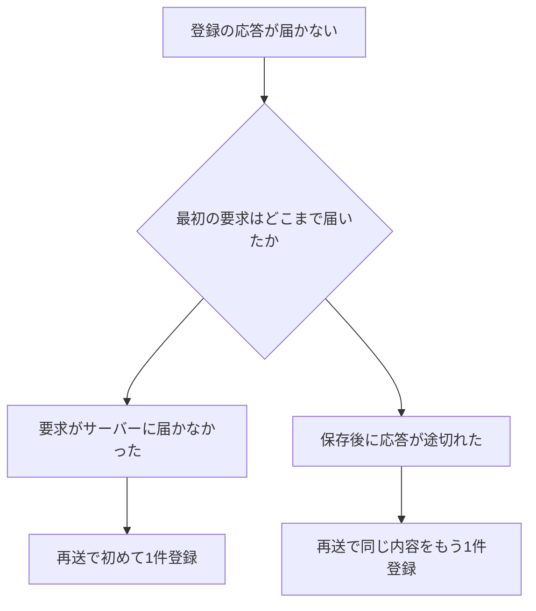

# 第4章　操作に合うメソッドを選ぶ

修理依頼を開くたびに台帳の件数が増えたら困ります。画面を開く目的は依頼を読むことで、新しい依頼を作るのは「登録」を押したときです。HTTP では、この違いを**メソッド**で伝えます。同じ宛先でも、読むときは `GET`、状態を変えるときは `PATCH` を使い分けます。

## 依頼を登録して、返された宛先を開く

**サンプルで試せる**　[起動手順](../package/app/README.md)で手元の API を起動し、Bash の端末で次を実行します。`curl` は HTTP のリクエストを送るコマンドです。小文字の `-i` を付けると、レスポンスのステータスとヘッダーも本文と一緒に読めます。

```bash
api=http://127.0.0.1:8000
curl -i -X POST "$api/repair-requests" \
  -H 'Content-Type: application/json' \
  -d '{"title":"椅子がぐらつく","location":"第2会議室"}'
```

`-X POST` は登録を依頼するメソッド、`-H` はヘッダー、`-d` は送る本文を指定します。ヘッダーの `Content-Type` は、その本文が JSON だと伝えます。成功すると次のように表示されます。番号はサーバーが採番します。

```http
HTTP/1.1 201 Created
location: /repair-requests/42
content-type: application/json

{"id":42,"title":"椅子がぐらつく","location":"第2会議室","status":"open"}
```

上は主なヘッダーを抜き出した例です。`201` は新しく作成できたという返事です。レスポンスヘッダーの `Location`（表示上は `location`）が、作成した依頼のパスです。同じ端末で次の1行目を実行し、実際に返ったパスを貼り付けて Enter を押します。その後に2行目を実行します。

```bash
read -r -p 'Location のパスを入力: ' repair_path
curl -i "$api$repair_path"
```

本文を付けずに URL を渡すと、curl は `GET` を送ります。`200 OK` と、登録時と同じ番号・件名・場所・状態が返れば、別のリクエストから同じ依頼を読めました。

次の例では、一覧の取得件数に範囲外の `0` を指定します。

```bash
curl -i "$api/repair-requests?limit=0"
```

レスポンスのステータスは `422`、`Content-Type` は `application/problem+json` です。この形式を **Problem Details** と呼びます。本文の `status` で結果を、`detail` でどの値を直すかを読めます。

```json
{"type":"about:blank","title":"Unprocessable Content","status":422,"detail":"入力の形式や範囲を確認してください（query.limit）。"}
```

## 成功したら何が変わるかで選ぶ

**サンプルで試せる**　表の `42` は登録時に返った番号に置き換えてください。PUT の行は、依頼に訪問指示を追加するときの設計例です。

| 行いたいこと | メソッドと宛先 | 送る値と成功時のレスポンス |
| --- | --- | --- |
| 未完了の依頼を並べる | `GET /repair-requests?status=open` | 本文なし。 `200` と一覧 |
| 依頼を1件開く | `GET /repair-requests/42` | 本文なし。 `200` とその依頼 |
| 新しい依頼を作る | `POST /repair-requests` | 件名と場所。 `201` と新しい宛先 |
| 完成形で置き換える（設計例・未実装） | `PUT /repair-requests/42/visit-instructions` | 訪問指示の全項目。作成なら `201`、置換なら `200` または `204` |
| 完了にする | `PATCH /repair-requests/42` | `{"status":"completed"}`。 `200` と更新後の依頼 |
| 自分が登録したテスト用の依頼を消す | `DELETE /repair-requests/42` | 本文なし。 `204 No Content`。その後の照会は `404` |

たとえば `POST /repair-requests/42/delete` と書くと、メソッドだけでは削除だと分かりません。誤登録を取り除く操作は `DELETE /repair-requests/42` で表せます。

同じ「未完了」という値でも、一覧を**探す**ときはクエリに、依頼の状態を**変える**ときは本文に置きます。リンクを開くだけで完了にする `GET /complete/42` のような設計だと、リンクの自動確認でも台帳が変わり得ます。読み取りと変更を分けておけば、画面の再表示は何度でもできます。

`PATCH` の本文は変更の指示です。このサンプルは `status` に `open` または `completed` を受け取り、件名と場所を保ちます。`{}` や `{"status":null}` は `422` です。変更できる項目や省略時の動作は、採用する形式と API の契約で決まります。

## レスポンスが途切れたとき、もう一度送れるか

登録の直後に通信が切れると、社員には「受付番号が届かなかった」としか分かりません。サーバーではすでに保存を終えているかもしれません。



HTTP でいう**安全（safe）**な操作では、利用者は対象の変更を求めません。`GET` は安全で、閲覧ログが記録されてもこの意味は変わりません。**冪等（べきとう）**な操作は、同じリクエストを繰り返しても意図した効果が1回分と同じです。`GET`、`PUT`、`DELETE` は冪等です。削除の1回目が `204`、2回目が `404` でも、同じ依頼は削除済みです。

修理依頼の `POST` は、同じ件名と場所をもう一度送ると別の依頼を作ります。

**設計例（未実装）**　自動再送で二重登録を防ぎたい場合は、登録操作に一意のキーを付け、同じキーの再送には最初の結果を返すなど、サーバーとクライアントの両方で取り決めます。

<details>
<summary>設計例（未実装）　PUT、取り消し、ログインはどう考えるか</summary>

**設計例（未実装）**　修理依頼を拡張する場合、何を送り、操作後に何を読めるようにしたいかで選びます。

| 相談されたこと | 設計の例 |
| --- | --- |
| 依頼ごとに一つの訪問指示を保存したい | 宛先が初めから分かるなら `PUT /repair-requests/42/visit-instructions` に指示の完成形を送る。新規作成なら `201`、置き換えなら `200` または `204` |
| 担当者を外したい | 部分変更で「省略は担当者を保つ」「`{"assignee_id":null}` は担当を解除する」と契約に書く。空文字 `""` は社員番号として受け付けず `422` とする。一度の `PATCH` に含まれる複数の変更はまとめて適用する |
| 消しても監査記録は残したい | `DELETE` 後は通常の照会から除き、内部に削除日時を残す論理削除も選べる。依頼自体は引き続き読めるようにするなら、アーカイブ状態に変える。取消理由や承認を追うなら、取消申請に番号を付ける |
| 計算結果だけ欲しい | 公開できる短い条件で集計を読むなら `GET`。多くの見積条件を本文で送るなら `POST /repair-estimates` で計算し、`200` と結果を返す。POST の用途には、結果を保存しない処理もある |
| パスワードでログインしたい | フォームを開くのは `GET`。本人確認とセッション開始は HTTPS の `POST /sessions` にパスワードを含む本文を送る。その後、自分の情報を読む `GET /me` では発行済みの Bearer トークンを `Authorization` ヘッダーに添える方式がある |

</details>

<details>
<summary>リクエストとレスポンスのヘッダーを読み分ける</summary>

| ヘッダー | 誰が何を伝えるか |
| --- | --- |
| `Content-Type` | 本文を送る側が、その形式を知らせる。修理依頼の登録は `application/json` |
| `Accept` | クライアントが受け取りたいレスポンスの形式を伝える。実際の形式はレスポンスの `Content-Type` にある |
| `Authorization` | クライアントが認証方式に応じた資格情報を渡す。AWS 構成ではリクエストへの署名に使う |
| `Location` | サーバーが、作成した依頼の宛先などを知らせる |

`GET` と `DELETE` のリクエストの本文には HTTP で一般に定めた意味がありません。一覧の条件はクエリ、削除対象はパスで伝えます。本文なしでレスポンスヘッダーを問い合わせるためのメソッドには `HEAD`、対象で使える通信上の選択肢を問い合わせるメソッドには `OPTIONS` があります。

</details>

## この章で決めたこと

- 照会は GET、サーバーが採番する登録は POST、状態だけの変更は PATCH を使う。
- 既知のパスに完成形を置くなら PUT、対象を取り除くなら DELETE を選ぶ。
- 通信が切れたら、同じリクエストを繰り返したときに登録や変更が重ならないか確かめる。

## 根拠と参考

- メソッドの意味と再送：[RFC 9110 §9.2 安全性・冪等性](https://www.rfc-editor.org/rfc/rfc9110.html#section-9.2)・[§9.3 各メソッド](https://www.rfc-editor.org/rfc/rfc9110.html#section-9.3)・[RFC 5789 §2 PATCH](https://www.rfc-editor.org/rfc/rfc5789.html#section-2)・[AWS Builders’ Library の再送設計](https://aws.amazon.com/builders-library/making-retries-safe-with-idempotent-APIs/)
- メッセージの読み方：[curl の `-i`](https://curl.se/docs/manpage.html#-i)・[RFC 9110 §8.3 Content-Type](https://www.rfc-editor.org/rfc/rfc9110.html#section-8.3)・[§10.2.2 Location](https://www.rfc-editor.org/rfc/rfc9110.html#section-10.2.2)・[§12.5.1 Accept](https://www.rfc-editor.org/rfc/rfc9110.html#section-12.5.1)・[RFC 9457 §3 Problem Details](https://www.rfc-editor.org/rfc/rfc9457.html#section-3)
- 設計例とサンプル：[Google AIP-164 論理削除](https://google.aip.dev/164)・[RFC 6750 §2.1 Bearer トークン](https://www.rfc-editor.org/rfc/rfc6750.html#section-2.1)・[修理依頼の OpenAPI 定義](openapi.yaml)・[FastAPI の処理](../package/app/main.py)

[前へ　第3章　パスとパラメータ](03-addresses.md) ｜ [目次](../README.md) ｜ [次へ　第5章　HTTP ステータスコードから次の行動を決める](05-responses.md)
