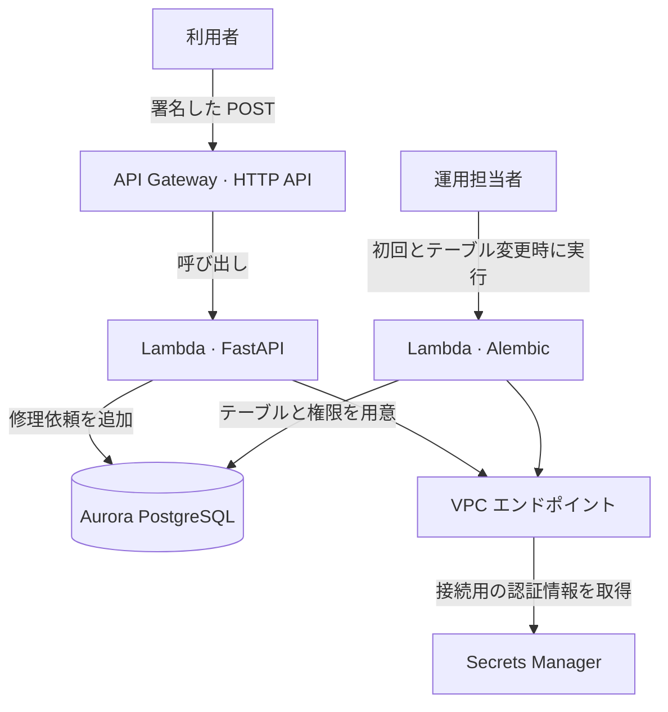

# 第8章　修理依頼の API を AWS に置く

手元で登録した修理依頼を、別の端末からも読めるようにしましょう。HTTP の契約は第7章と同じです。AWS では入口で利用者の権限を確かめ、依頼を共有のデータベースに保存します。

## 1件の登録が通る道



利用者は **API Gateway** の URL を呼びます。API Gateway は AWS の署名と権限を確認し、リクエストを **Lambda** に渡します。Lambda はリクエストを受けたときにコードを実行するサービスです。ここでは Mangum が AWS のイベントを FastAPI に渡し、第7章の関数が **Aurora PostgreSQL** に依頼を保存します。API Gateway の製品区分は「HTTP API」を選びました。第2章で学んだ REST は、この API の設計に使う考え方です。[HTTP API の IAM 認可](https://docs.aws.amazon.com/apigateway/latest/developerguide/http-api-access-control-iam.html) ／ [Mangum](https://mangum.fastapiexpert.com/)

図の下側は、テーブルの作成や変更に使う経路です。API 用の DB ユーザー `repair_api` は修理依頼の読み書きを担当します。テーブルを作れる管理用ユーザーの認証情報は、マイグレーション用 Lambda が読みます。2つの関数は同じイメージから起動し、それぞれ別の Python 関数を実行します。[構成のコード](../package/infra/app.py) ／ [Lambda のコンテナイメージ](https://docs.aws.amazon.com/lambda/latest/dg/python-image.html)

データベースと両方の Lambda を、インターネットへの経路を持たないサブネットに置きます。Lambda は VPC エンドポイントというプライベートな接続口から Secrets Manager にアクセスします。DB に接続するときは、AWS が配布する認証局の証明書で接続先を検証します。[Secrets Manager の VPC エンドポイント](https://docs.aws.amazon.com/secretsmanager/latest/userguide/vpc-endpoint-overview.html) ／ [Aurora の TLS 証明書](https://docs.aws.amazon.com/AmazonRDS/latest/AuroraUserGuide/UsingWithRDS.SSL.html)

## 演習環境を準備する

以下は Bash 用です。Windows では WSL の Bash を使えます。第7章の Python 3.12 環境に加え、AWS CLI v2、AWS CDK CLI v2、Linux コンテナをビルドできる Docker、curl 7.75 以降を用意します。AWS CLI には、演習用アカウントで利用できる一時認証情報を設定しておきます。[CDK の導入](https://docs.aws.amazon.com/cdk/v2/guide/getting-started.html) ／ [curl の署名オプション](https://curl.se/docs/manpage.html#--aws-sigv4)

**デプロイすると利用料が発生します。** この構成では Aurora の最小容量を 0 ACU に設定しています。接続のない状態が5分続いて自動停止すれば、停止中のインスタンス容量の課金は止まります。DB のストレージ、Secrets Manager、2つのアベイラビリティーゾーンに置く VPC エンドポイントなどには料金がかかります。コードを読むだけなら、次の手順は任意です。[Aurora の自動停止](https://docs.aws.amazon.com/AmazonRDS/latest/AuroraUserGuide/aurora-serverless-v2-auto-pause.html) ／ [Aurora の料金](https://aws.amazon.com/rds/aurora/pricing/) ／ [PrivateLink の料金](https://aws.amazon.com/privatelink/pricing/) ／ [Secrets Manager の料金](https://aws.amazon.com/secrets-manager/pricing/)

リポジトリのルートで Bash 用の仮想環境を有効にします。第7章を Windows の PowerShell で試した場合は、WSL 内で `python3.12 -m venv .venv-aws` を実行し、先頭行を `source .venv-aws/bin/activate` に置き換えてください。`AWS_REGION` は東京リージョンの例です。`aws sts get-caller-identity` に表示されたアカウントとロールを確認します。

```bash
source .venv/bin/activate
cd package/infra
python -m pip install -r requirements.txt
export AWS_REGION=ap-northeast-1
aws sts get-caller-identity
ACCOUNT=$(aws sts get-caller-identity --query Account --output text)
```

[cdk.json](../package/infra/cdk.json) の `auroraVersion` は `17.7` です。次のコマンドで `db.serverless` を作成できるバージョンを確認します。既定値が候補にない場合は、候補の 17 系マイナーバージョンに `cdk.json` を更新してください。[Aurora のリージョン別対応確認](https://docs.aws.amazon.com/AmazonRDS/latest/AuroraUserGuide/aurora-serverless-v2.requirements.html)

```bash
aws rds describe-orderable-db-instance-options \
  --engine aurora-postgresql --db-instance-class db.serverless \
  --query 'OrderableDBInstanceOptions[].EngineVersion' --output text
```

## インフラを作り、テーブルを用意する

初めて CDK を使うアカウントとリージョンの組み合わせでは、`cdk bootstrap` を一度実行します。イメージの保管先などを作る操作です。組織が準備済みなら `cdk synth` から始めます。`synth` は CloudFormation のテンプレートを生成し、`diff` は適用予定の差分を表示します。[CDK のブートストラップ](https://docs.aws.amazon.com/cdk/v2/guide/bootstrapping.html)

```bash
cdk bootstrap "aws://$ACCOUNT/$AWS_REGION"
export BUILDX_NO_DEFAULT_ATTESTATIONS=1
cdk synth RepairApi
cdk diff RepairApi
cdk deploy RepairApi --outputs-file cdk.out/repair-outputs.json
```

デプロイが完了すると、API の URL、マイグレーション用 Lambda の名前、呼び出し許可に使う ARN が出力されます。次のコマンドは出力ファイルから値を取り出し、テーブルを作ります。実行するロールには、この関数への `lambda:InvokeFunction` が必要です。API を利用するだけのロールにこの権限を付ける必要はありません。[AWS CLI の Lambda invoke](https://docs.aws.amazon.com/cli/latest/reference/lambda/invoke.html)

```bash
stack_output() {
  python -c 'import json, sys; print(json.load(open("cdk.out/repair-outputs.json"))["RepairApi"][sys.argv[1]])' "$1"
}
API=$(stack_output ApiUrl)
MIGRATE=$(stack_output MigrateFunction)
aws lambda invoke --function-name "$MIGRATE" --cli-read-timeout 150 \
  --payload '{}' --cli-binary-format raw-in-base64-out cdk.out/migrate.json
cat cdk.out/migrate.json
```

呼び出し結果に `FunctionError` がなく、返却ファイルに `{"migration":"up-to-date"}` があることを確認してから API を使います。`StatusCode: 200` は Lambda が呼び出しを受け付けたことを示し、関数内の例外も `FunctionError` として返ります。再実行すると Alembic が適用済みの版を確認します。[マイグレーションの実装](../package/db/migrate.py) ／ [同期呼び出しの応答](https://docs.aws.amazon.com/cli/latest/reference/lambda/invoke.html)

## 利用者の権限で1件登録する

`stack_output InvokeArn` の値を、利用者の IAM ポリシーの `Resource` に設定します。許可するアクションは `execute-api:Invoke`、`Effect` は `Allow` です。教材では `$default` ルートにまとめて許可するため、この権限を持つ人は修理依頼を登録・変更・削除できます。[API の ARN 形式](https://docs.aws.amazon.com/apigateway/latest/developerguide/arn-format-reference.html) ／ [IAM 認可](https://docs.aws.amazon.com/apigateway/latest/developerguide/http-api-access-control-iam.html)

次の例では、一時認証情報を同じ括弧内のシェルだけで使い、curl がリクエストごとに署名を作ります。新規環境では最初の GET が `200` と空の `items` を返し、POST が `201` と作成した依頼を返します。自動停止からの復帰に時間がかかった場合は、まず GET でもう一度確認します。登録の応答が途切れたときの調べ方は[第4章](04-methods.md)を参照してください。[AWS CLI の認証情報の受け渡し](https://docs.aws.amazon.com/cli/latest/reference/configure/export-credentials.html) ／ [curl の SigV4](https://curl.se/docs/manpage.html#--aws-sigv4)

```bash
(
  source <(aws configure export-credentials --format env)
  signed_curl() {
    curl --silent --show-error --include --config - "$@" <<SIGN
aws-sigv4 = "aws:amz:$AWS_REGION:execute-api"
user = "$AWS_ACCESS_KEY_ID:$AWS_SECRET_ACCESS_KEY"
header = "x-amz-security-token: $AWS_SESSION_TOKEN"
SIGN
  }
  signed_curl "$API/repair-requests"
  signed_curl "$API/repair-requests" --header 'Content-Type: application/json' \
    --data '{"title":"椅子の脚を直す","location":"第1会議室"}'
)
```

| 観察した結果 | 最初に調べる場所 |
| --- | --- |
| 署名付きの呼び出しが `403` | ロールの `execute-api:Invoke`、対象 ARN、認証情報の期限、署名のリージョン |
| マイグレーションに `FunctionError` | `cdk.out/migrate.json` とマイグレーション用 Lambda のログ。DB への接続と認証情報の取得を確認 |
| 新規登録で `422` | 第5章のエラー形式と送った `title`、`location`。入力を直して再度送信 |

## 演習を終了する

`package/infra` で次のコマンドを実行し、対象を確認してから削除を確定します。**この演習スタックを削除すると、修理依頼のデータも削除されます。** ほかの人が利用中の環境や保管が必要なデータがある場合は、事前にバックアップを用意してください。CDK のブートストラップ用スタックと、そこに保管されたイメージは別に管理されます。[スタックの設定](../package/infra/app.py) ／ [CDK のブートストラップ](https://docs.aws.amazon.com/cdk/v2/guide/bootstrapping.html)

```bash
cdk destroy RepairApi
```

[← 第7章　FastAPI で実装](07-fastapi.md) ｜ [第9章　別の業務で設計してみる →](09-practice.md)
