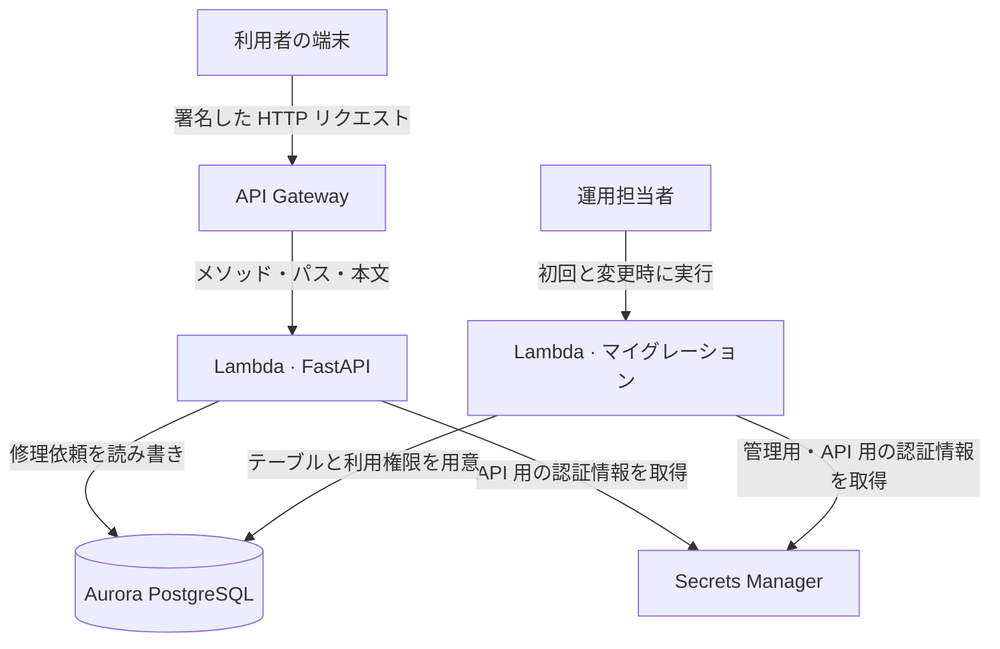

# 第9章　設計した API を AWS で動かす

総務の担当者が自分の端末から椅子の修理を依頼し、別の担当者がその依頼を開くとします。2人が必要とするのは、同じ URL と、同じ依頼が保存される場所です。この章では、第8章の API を AWS に置く例を使い、入口から保存先までをどうつなぐか考えます。

## 登録ボタンを押すと何が動くか

利用者の端末は `POST /repair-requests` を送ります。**Amazon API Gateway** は公開した HTTPS の窓口で要求を受け、呼び出し元の権限を確かめます。**AWS Lambda** は、その要求を受け取って Python 関数を実行します。**Amazon Aurora PostgreSQL** は、関数から SQL を受け取り、修理依頼をテーブルに保存するデータベースです。



登録に成功すると、FastAPI は `201 Created` と新しい依頼の `Location` を返します。利用者はその場所に GET を送れば、別の端末からも同じ依頼を読めます。AWS 上の配置を変えても、第8章で実装したメソッド、パス、応答の意味は共通です。[FastAPI の実装](../package/app/main.py) ／ [AWS 公式の Lambda プロキシ統合](https://docs.aws.amazon.com/apigateway/latest/developerguide/http-api-develop-integrations-lambda.html)

## API Gateway に、誰の要求をどこへ渡すか教える

この例で使う API Gateway の製品区分は「HTTP API」です。入口の設定で決めるのは、呼び出しを許可する条件と、その先で動かす関数です。[CDK の実装](../package/infra/app.py)では、次の2行で表しています。

```python
default_authorizer=authorizers.HttpIamAuthorizer(),
default_integration=integrations.HttpLambdaIntegration("FastAPI", api_handler),
```

1行目は、AWS の権限管理サービス **IAM** で呼び出し元を確認する設定です。利用者は AWS の認証情報で要求に署名します。API Gateway は署名を検証し、その利用者に対象 API の `execute-api:Invoke` が許可されていれば、要求を先に進めます。この教材は社内の共有台帳を想定し、この許可を持つ利用者が登録・参照・変更・削除を行えます。[HTTP API の IAM 認可](https://docs.aws.amazon.com/apigateway/latest/developerguide/http-api-access-control-iam.html)

2行目は、`$default` ルートが受けた要求を API 用 Lambda に渡す設定です。この構成では `/repair-requests` も `/repair-requests/42` も同じ関数に届きます。利用者への許可とは別に、Lambda 側にも「この API Gateway からの呼び出しを受ける」という許可が必要です。`HttpLambdaIntegration` が関数のポリシーにその許可を追加します。[CDK の統合処理](https://github.com/aws/aws-cdk/blob/v2.220.0/packages/aws-cdk-lib/aws-apigatewayv2-integrations/lib/http/lambda.ts) ／ [API Gateway が Lambda を呼ぶための権限](https://docs.aws.amazon.com/lambda/latest/dg/services-apigateway.html#services-apigateway-permissions)

API Gateway はメソッド、パス、ヘッダー、本文を、ペイロード形式 2.0 のイベントにまとめます。Lambda の入口は `package.app.main.handler` です。ここで `Mangum(app, lifespan="off")` がイベントを FastAPI が扱える形式へ変換します。あとは FastAPI が `@app.post("/repair-requests")` の関数を選びます。戻り道では、Mangum が FastAPI の応答を API Gateway 向けに変換します。[イベントの形式](https://docs.aws.amazon.com/apigateway/latest/developerguide/http-api-develop-integrations-lambda.html) ／ [Mangum](https://mangum.fastapiexpert.com/)

**ステージ**は、API Gateway の設定をデプロイする公開先です。このサンプルの `$default` ステージには、URL にステージ名を足さず、`/repair-requests` でアクセスできます。一方、利用者に `/v1` と `/v2` を選んでもらう場合は、各パスでどの契約を提供するかを決めます。[AWS「HTTP API のステージ」](https://docs.aws.amazon.com/apigateway/latest/developerguide/http-api-stages.html)・[第11章　API のバージョンを上げる](11-versioning.md)

## Lambda から保存先までをつなぐ

データベースには公開 IP アドレスを割り当てず、Lambda から AWS 内の仮想ネットワーク **VPC** を通して接続します。1件の登録には、次の3つがそろう必要があります。[Lambda の VPC 接続](https://docs.aws.amazon.com/lambda/latest/dg/configuration-vpc.html)

| 何をつなぐか | このサンプルの設定 | 設定が必要な理由 |
| --- | --- | --- |
| Lambda → Secrets Manager | VPC エンドポイントの `private_dns_enabled=True`。関数から TCP 443 を許可し、`secret.grant_read(fn)` で読み取りを許可 | SDK が通常のサービス名を VPC 内の接続先に解決し、API 用のユーザー名とパスワードを取得するため |
| Lambda → Aurora | 同じ VPC の隔離サブネットを使い、`cluster.connections.allow_default_port_from(functions_sg)` を指定 | DB が Lambda のセキュリティグループから PostgreSQL の TCP 5432 への接続を受けるため |
| Python → 修理依頼テーブル | `DB_HOST` に書き込み先のホスト名、`DB_NAME` に `repairs` を設定。`repair_api` でログイン | 保存先を指定し、そのユーザーに許された範囲で行を読み書きするため |

セキュリティグループは通信の通り道を制御します。そこで接続が許可されても、DB で実行できる SQL は PostgreSQL の権限で決まります。接続時には `sslmode=verify-full` を指定し、AWS 配布の証明書で接続先の証明書とホスト名も検証します。[セキュリティグループ](https://docs.aws.amazon.com/ja_jp/vpc/latest/userguide/vpc-security-groups.html) ／ [Secrets Manager の VPC 接続](https://docs.aws.amazon.com/secretsmanager/latest/userguide/vpc-endpoint-overview.html) ／ [Aurora の TLS](https://docs.aws.amazon.com/ja_jp/AmazonRDS/latest/AuroraUserGuide/AuroraPostgreSQL.Security.html) ／ [接続コード](../package/app/database.py)

テーブルを最初に用意するのが、図のもう一つの Lambda です。運用担当者がマイグレーション用の関数を呼ぶと、Alembic が未適用のテーブル変更を順に実行し、続いて `repair_api` に修理依頼テーブルの読み書きなどを許可します。2つの関数のうち、テーブル変更に使う管理用の認証情報を読み取れるのはマイグレーション用の関数だけです。その後、利用者は API 用の関数を通じて同じテーブルを使います。[マイグレーション](../package/db/migrate.py) ／ [DB の権限設定](../package/db/app_role.py)

## 要求がどこまで届いたか確かめる

| 観察した結果 | 最初に確かめること |
| --- | --- |
| API Gateway が `403` を返す | 利用者の署名、認証情報の期限、リージョン、対象 API の `execute-api:Invoke` |
| API 用 Lambda が一度も呼び出されない | API Gateway のルートと統合先、Lambda が API Gateway に与えた呼び出し許可 |
| Lambda は動くが、秘密の取得に失敗する | Lambda のログで、権限エラーなら対象シークレットの読み取り権限、タイムアウトならエンドポイントの DNS と TCP 443 |
| DB 接続や SQL が失敗する | 接続タイムアウトなら `DB_HOST` と TCP 5432。テーブルや権限のエラーならマイグレーションの実行結果 |

**コマンドでは登録できるのに、Web 画面からだけ失敗したら。** `https://staff.example.com` の画面から `https://api.example.com` を呼ぶと、ホスト名が違うので別の**オリジン**（スキーム・ホスト・ポートの組）になります。どのオリジンの画面に応答を読ませるかをブラウザーに伝える仕組みが **CORS** です。ブラウザーの開発者ツールで「ネットワーク」を開くと、署名付きの登録要求 `POST` の前に、許可を確かめる `OPTIONS` が見えます。その応答で、画面のオリジン、`POST`、署名や本文に使うヘッダーが許可されているかを確認します。[Fetch Standard「CORS protocol」](https://fetch.spec.whatwg.org/#http-cors-protocol)

この画面を追加するなら、HTTP API の CORS 設定でオリジンとメソッドを指定し、`Content-Type`、`Authorization`、`X-Amz-Date` など実際に送るヘッダーを許可します。登録先を画面で読むには、`exposeHeaders` に `Location` を指定します。教材の `$default` ルートには IAM 認可があるため、事前確認用に認可を求めない `OPTIONS /{proxy+}` ルートを追加し、統合先を設定します。実際に登録する `POST` では、引き続き署名と `execute-api:Invoke` を確認します。[AWS「HTTP API の CORS 設定」](https://docs.aws.amazon.com/apigateway/latest/developerguide/http-api-cors.html)

AWS で試す場合は、[デプロイ・動作確認・削除の手順](../package/infra/README.md)に進んでください。次の章では、修理依頼で決めたことを手がかりに、別の業務の API を設計します。

[← 第8章　FastAPI で実装する](08-fastapi.md) ｜ [第10章　別の業務で設計してみる →](10-practice.md)
