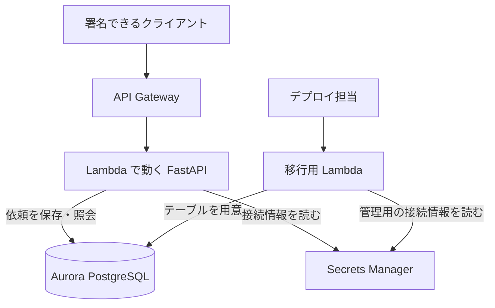

# 第10章　設計した API を AWS で動かす

**サンプルで試せる**　手元で登録した修理依頼を、別の端末からも同じ受付番号で開きたいとします。この章では受付 API と台帳を AWS に置きます。API の使い方は手元と同じです。新たに決めるのは、誰のリクエストを通し、どの関数がどのデータベースを使うかです。

## 登録ボタンから台帳まで

`POST /repair-requests` を受け取る入口が **Amazon API Gateway** です。権限の確認を通ると、**AWS Lambda** がリクエストを受けて Python の関数を実行します。関数は **Amazon Aurora PostgreSQL** に件名と場所を保存し、受付番号を返します。



登録が済むと `201 Created` と `Location` が返ります。続けてそのパスに署名付きの `GET` を送れば、今登録した依頼を開けます。

## API Gateway と Lambda をつなぐ

このサンプルは API Gateway の **HTTP API** を使います。Python CDK の次の2行で、入口が確認する権限と、処理を任せる関数を指定します。

```python
default_authorizer=authorizers.HttpIamAuthorizer(),
default_integration=integrations.HttpLambdaIntegration("FastAPI", api_handler),
```

1行目で選ぶ **IAM** は AWS の権限管理の仕組みです。サンプルでは、開発者や CI が一時的な AWS 認証情報でリクエストに署名します。API Gateway は署名と `execute-api:Invoke` 権限を確認します。共有台帳の動作を少ない設定で検証するため、この構成を選びました。

2行目は `$default` ルートに届いたリクエストを API 用 Lambda に渡します。CDK は Gateway が関数を呼ぶ許可も設定します。Lambda の入口 `package.app.main.handler` では Mangum がイベントを FastAPI に渡し、FastAPI がメソッドとパスに対応する処理を選びます。公開先は `$default` ステージなので、利用者は URL にステージ名を足さずに呼べます。

**設計例（未実装）　社員向けの画面を用意する場合。** 第1章の社員がスマートフォンで操作するなら、たとえば会社のログイン基盤でサインインし、画面から API にアクセストークンを送ります。API Gateway の JWT オーソライザーはトークンの署名、発行元、有効期限などを検証し、確認した情報を Lambda に渡します。アプリは発行元と利用者 ID から社員を特定し、社員台帳の所属や保存済みの依頼者と照合して、閲覧・変更を許可します。社員が端末に AWS のアクセスキーを設定する手順はありません。

## Lambda と Aurora をつなぐ

| 必要な設定 | このサンプルでの役割 |
| --- | --- |
| 通信経路 | Lambda と Aurora を同じ VPC（仮想ネットワーク）の隔離サブネットに置く。Aurora のセキュリティグループで、Lambda からの TCP 5432 を許す |
| 接続情報 | Lambda は VPC エンドポイント経由で Secrets Manager に接続する。TCP 443 の通信と、API 用シークレットを読む IAM 権限を与える |
| DB の接続先と権限 | `DB_HOST` と `DB_NAME` で接続先を指定する。`sslmode=verify-full` で証明書とホスト名を確認し、`repair_api` に許可した範囲でテーブルを読み書きする |

初回のデプロイでは、移行用 Lambda が Alembic を使ってテーブルを作り、API 用の DB ユーザーに必要な権限を与えます。API 用 Lambda は日々の登録と照会を受け持ちます。2つの役割を分けることで、通常のリクエストを処理する関数に、テーブルの構造を変える権限を渡さずに済みます。

## つながったことを確かめる

デプロイ後は GitHub Actions の **Deploy to AWS** で `aws-smoke-report` を開きます。署名なしの一覧取得は `403`、署名付きで `limit=1` なら `200`、同じ署名方式でも `limit=0` なら入力エラーの `422` が期待値です。一覧が空でも、`200` と正しい形式の一覧が届けば、Gateway から台帳まで読めたことが分かります。

<details>
<summary>発展　リクエストが途中で止まったときの調べ方</summary>

| 症状 | 最初に確かめるところ |
| --- | --- |
| 署名付きでも Gateway が `403` を返す | 署名のリージョン、認証情報の有効期限、対象 API の呼び出し権限 |
| Lambda が呼ばれない | Gateway のルート・統合先と、Gateway から Lambda を呼ぶ許可 |
| DB の接続情報を取得できない | シークレットの読み取り権限。タイムアウトならエンドポイントの DNS と TCP 443 |
| SQL でエラーになる | タイムアウトなら接続先と TCP 5432。テーブルや権限のエラーならマイグレーション結果 |

</details>

<details>
<summary>設計例（未実装）　コマンドでは通るのに、別の Web 画面からだけ登録できない</summary>

画面が `https://staff.example.com`、API が `https://api.example.com` なら、別のオリジンです。どのオリジンの画面にレスポンスを読ませるかをブラウザーに伝える仕組みを **CORS** と呼びます。ブラウザーのネットワーク表示で、登録に先立つ `OPTIONS` のレスポンスを確認します。HTTP API 側で画面のオリジン、使うメソッド、送信するヘッダーを許可し、画面で登録先を読むには `Location` を公開するヘッダーに加えます。

教材のように `$default` ルートに IAM 認可がある場合は、事前確認用に認可を求めない `OPTIONS /{proxy+}` ルートと統合先を用意します。登録を行う `POST` には引き続き認可を適用します。

</details>

## この章で決めたこと

- 入口で呼び出し権限を確認し、同じ Lambda にメソッド・パス・入力を渡す。
- DB へ到達する経路、認証情報を読む権限、DB 内での権限をそれぞれ設定する。
- 配置後は署名付きの照会で、利用者の入口から実データの読み取りまで確かめる。

## 根拠と参考

- **入口と認可**　[AWS の IAM 認可](https://docs.aws.amazon.com/apigateway/latest/developerguide/http-api-access-control-iam.html)・[JWT オーソライザー](https://docs.aws.amazon.com/apigateway/latest/developerguide/http-api-jwt-authorizer.html)・[HTTP API の CORS 設定](https://docs.aws.amazon.com/apigateway/latest/developerguide/http-api-cors.html)
- **関数へ渡す方法**　[Lambda プロキシ統合とイベント形式](https://docs.aws.amazon.com/apigateway/latest/developerguide/http-api-develop-integrations-lambda.html)・[API Gateway が Lambda を呼ぶ許可](https://docs.aws.amazon.com/lambda/latest/dg/services-apigateway.html#services-apigateway-permissions)
- **保存先への接続**　[Lambda の VPC 接続](https://docs.aws.amazon.com/lambda/latest/dg/configuration-vpc.html)・[Secrets Manager の VPC 接続](https://docs.aws.amazon.com/secretsmanager/latest/userguide/vpc-endpoint-overview.html)・[Aurora の TLS](https://docs.aws.amazon.com/ja_jp/AmazonRDS/latest/AuroraUserGuide/AuroraPostgreSQL.Security.html)
- [CDK の実装](../package/infra/app.py)・[接続コード](../package/app/database.py)・[デプロイ手順と疎通確認](../package/infra/README.md)

[前へ　第9章　仕様書の約束を FastAPI で実装する](09-fastapi.md) ｜ [目次](../README.md) ｜ [次へ　第11章　API のバージョンを上げる](11-versioning.md)
