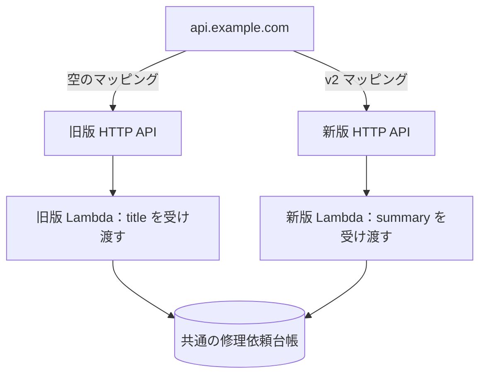

# 第11章　API のバージョンを上げる

修理依頼の件名 `title` を `summary` に変えたいとします。先にサーバーだけを更新すると、昨日まで使えていた画面は `title` を送り続け、登録に失敗します。一方、一覧に任意の絞り込み条件を足すだけなら、以前の画面は同じ URL をそのまま使えます。バージョンアップでは、最初に **「今の利用者が何も変えずに、同じ仕事を続けられるか」** を確かめます。[Google AIP-180「後方互換性」](https://google.aip.dev/180)

## 変更を見て、どの番号を上げるか決める

**セマンティックバージョニング（SemVer）** は、公開した契約の変更を `メジャー.マイナー.パッチ` の3つの数字で示す約束です。次はどれも、修理依頼 API の公開版 `1.0.0` から変更する例です。[SemVer 2.0.0](https://semver.org/lang/ja/)

| 変更したいこと | 旧版を使う人への影響 | 次の版と公開先 |
| --- | --- | --- |
| 仕様どおりのエラーが返らない不具合を直す | 既に約束した応答に戻る | パッチ `1.0.1`。同じ URL を更新する |
| 一覧に任意の `location` 絞り込みを足す | 省略したときの対象・順序・件数は従来どおり | マイナー `1.1.0`。同じ URL を更新する |
| 登録・照会の `title` を廃止し、`summary` に改名する | 従来の登録本文が通らず、従来の画面は応答から件名を読めない | メジャー `2.0.0`。移行期間は旧版と新版の両方を提供する |

項目の**追加**でも、互換性は送り手と受け手の双方で確かめます。たとえばサンプルの応答にある `status` の値は `open` と `completed` の2種類です。`in_progress` を返し始めると、この2種類だけを受け付ける旧画面では一覧全体を読めなくなる可能性があります。スキーマの差分に加え、以前の要求と実際のクライアントで結果を確認します。[修理依頼の型定義](../package/app/schemas.py)・[Google AIP-180「項目の追加と意味の変更」](https://google.aip.dev/180#adding-components)

## URL にバージョンとステージを入れるか

URL を決めるときは、**利用者が選ぶ契約**と、**運用担当者が公開する環境**を別々に考えます。

| 何を決めたいか | この教材での選び方 |
| --- | --- |
| 最初の URL に版を付けるか | 利用者と提供者が一緒に移行でき、一つの契約を保てる社内 API なら `/repair-requests` で始められる。複数の利用者が自分のタイミングで移行する前提なら、最初から `/v1/repair-requests` としておく |
| URL にどこまで番号を出すか | パスで契約を選ばせるなら `/v1`、`/v2` とメジャー番号を出す。`1.0.0` から `1.1.0` に上げても、v1 の利用者は URL を書き換えずに済む |
| 本番と検証をどう見分けるか | 公開用ドメインを持つなら、本番を `api.example.com`、検証を `api-dev.example.com` とする例がある。両方で同じ `/v1/repair-requests` を使える。利用者には接続先を環境ごとに案内する |

パスで版を選ぶ方法は設計上の選択です。Google はメジャー番号をパスに含め、GitHub の REST API はリクエストヘッダーで版を選べます。ヘッダー方式を採る場合は、省略時にどの契約で応答するかも仕様に書きます。[Google AIP-185「API Versioning」](https://google.aip.dev/185)・[GitHub のバージョン指定](https://docs.github.com/en/rest/about-the-rest-api/api-versions#specifying-an-api-version)

### API Gateway のステージ名が URL に現れる条件

ここで扱う AWS のサービスは、サンプルが使う **API Gateway の HTTP API** です。**デプロイメント**はルートや統合先といった API 設定を保存したもの、**ステージ**はそのデプロイメントを公開するための名前です。たとえば `prod` は本番の公開先を示せます。同じ `prod` に新しいデプロイメントを出せるので、リリースのたびにステージを作る必要はありません。[AWS「HTTP API のステージ」](https://docs.aws.amazon.com/apigateway/latest/developerguide/http-api-stages.html)

| 入口の設定 | 利用者が呼び出す URL の例 |
| --- | --- |
| AWS 標準ドメイン、サンプルの `$default` ステージ | `https://{api-id}.execute-api.{region}.amazonaws.com/repair-requests` |
| AWS 標準ドメイン、名前付きステージ `prod` | `https://{api-id}.execute-api.{region}.amazonaws.com/prod/repair-requests` |
| カスタムドメインで `v1` を `prod` ステージに割り当てる | `https://api.example.com/v1/repair-requests` |

3行目の割り当てを AWS では **API マッピング**と呼びます。Gateway は先頭の `v1` を使って転送先を選び、選ばれた API は `/repair-requests` を処理します。ステージ名を `dev`、`prod` と分けても、両方が同じ Lambda と DB を使えば同じ台帳が更新されます。検証環境を分けたいときは、転送先と保存先も確認します。[AWS「カスタムドメインと API マッピング」](https://docs.aws.amazon.com/apigateway/latest/developerguide/http-api-mappings.html)・[AWS「Lambda に渡すパス」](https://docs.aws.amazon.com/apigateway/latest/developerguide/http-api-develop-integrations-lambda.html)

**現在のサンプルは1行目**です。CDK が一つの HTTP API と自動デプロイを有効にした `$default` ステージを作り、FastAPI が `/repair-requests` を公開します。ステージの自動デプロイは、Gateway 設定への変更をそのステージに反映する機能です。[サンプルの CDK](../package/infra/app.py)・[使用中の CDK の既定値](https://github.com/aws/aws-cdk/blob/v2.220.0/packages/aws-cdk-lib/aws-apigatewayv2/lib/http/api.ts)

生成される OpenAPI の `openapi: 3.1.0` は仕様書の書式、`info.version: 1.0.0` はその文書の版です。`FastAPI(version="1.1.0")` と更新したときに変わるのは文書に載る番号です。新しい公開パスを作るには、ルートか API マッピングを設定します。[サンプルの OpenAPI 定義（YAML）](openapi.yaml)・[OpenAPI の Info Object](https://spec.openapis.org/oas/v3.1.1.html#info-object)

## 互換性を保てる場合は、同じ URL を更新する

一覧に場所の絞り込みを加える例なら、先に今のクライアントが送る `GET /repair-requests` をテストとして残します。次に任意のクエリパラメータ `location` を実装し、従来の要求では同じ一覧が返り、`GET /repair-requests?location=A` では A の依頼だけが返ることを確かめます。この順番なら、新機能と互換性を別々に確認できます。

サンプルでこの変更をリリースする場合は、FastAPI に公開版 `1.1.0` を記録し、リポジトリのルートで次を実行します。生成した差分を読み、旧版のテストを通してから、検証環境、本番環境の順に反映します。現在の CI の `--check` が確かめるのは、コードと保存済みの OpenAPI が一致することです。過去の利用者がそのまま動くかは、残しておいた要求と応答で確かめます。[アプリの実装・テスト方針](../package/app/README.md)

```console
uv run --locked python -m package.app.export_openapi docs/openapi.yaml docs/openapi.json
```

## 互換性を保てない場合は、旧版と新版を並行稼働させる

`title` を `summary` に改名する場合を考えます。すでに `/repair-requests` を利用する画面があれば、**その宛先を旧版として残し、新しい画面を `/v2/repair-requests` に向けます**。既存の利用者には `/v1` への引っ越しも求めません。

次の図は、カスタムドメインを追加し、版ごとに HTTP API と Lambda を分ける構成例です。`api.example.com` の証明書と DNS を用意し、空のマッピングを旧版、`v2` を新版のステージに割り当てます。すでに AWS 標準ドメインを案内している相手には、元の API ID と URL も引き続き提供します。[AWS「HTTP API のカスタムドメイン」](https://docs.aws.amazon.com/apigateway/latest/developerguide/http-api-custom-domain-names.html)



図では両 API の `$default` ステージを使います。両方の Lambda が同じ受付番号の件名を読み、旧版は `title`、新版は `summary` として返せば、改名だけのために DB の列まで変えずに済みます。小さな API なら、一つの FastAPI に旧版・新版のルートを置き、アプリ側で `/v2` を処理する方法もあります。[AWS「API マッピングの振り分け」](https://docs.aws.amazon.com/apigateway/latest/developerguide/http-api-mappings.html)

AWS ではステージ自体に `v1`、`v2` と名付けることもできます。ただし両方を同じ Lambda に向け、そのコードを上書きすれば、変更は両方の利用者に届きます。ステージで版を分ける場合も、各ステージが対応する実装を呼ぶように設定します。[AWS「HTTP API のステージ」](https://docs.aws.amazon.com/apigateway/latest/developerguide/http-api-stages.html)・[ステージ変数で Lambda の統合先を指定する例](https://docs.aws.amazon.com/apigateway/latest/developerguide/http-api-stages.stage-variables-reference.html)

1. **並行稼働の準備をする。** 旧版の仕様書とテストを保存し、新版の仕様書と送り方の例を用意します。共有 DB の変更が必要なら、まず旧コードでも読める列を加えます。このサンプルの CD はスタック更新後にマイグレーションを実行するため、先行する DB 変更が対象環境で完了したことを確認してから、その列を必要とする新版を配信します。[CD の実行順](../package/infra/README.md)・[AWS「切り戻せる変更の進め方」](https://aws.amazon.com/builders-library/ensuring-rollback-safety-during-deployments/)
2. **両方の公開 URL をテストする。** 旧版で登録した42番を新版でも読めるか、新版で更新した件名を旧版でも読めるかを試します。今の `Location: /repair-requests/42` はホスト直下を指すので、URL に `/v2` や `/prod` を付けると、その部分が落ちます。新版なら `Location: /v2/repair-requests/42` を返し、その宛先をそのまま `GET` します。Swagger UI からの要求も同じ公開 URL に届くこと、利用者に新しい API を呼ぶ IAM 権限があることを確かめます。[RFC 9110 §10.2.2 Location](https://www.rfc-editor.org/rfc/rfc9110.html#section-10.2.2)・[現在の契約テスト](../tests/contract/check.py)
3. **利用者ごとに切り替える。** 移行手順を渡し、対応できた利用者から新版に向けます。版ごとの件数とエラー率で、旧版の利用と新版の失敗を把握します。利用元まで調べるには、ステージのアクセスログを有効にし、記録した呼び出し元を利用システムと照合します。不具合の際は、旧契約を使えるクライアントを旧版に戻すか、新版には同じ契約を満たす正常な実装を再配信します。[AWS「HTTP API のアクセスログ」](https://docs.aws.amazon.com/apigateway/latest/developerguide/http-api-logging.html)・[ログに記録できる項目](https://docs.aws.amazon.com/apigateway/latest/developerguide/http-api-logging-variables.html)
4. **利用が終わってから旧版を閉じる。** 非推奨にする日、提供終了予定日、移行先を事前に案内します。旧版の応答でも `Deprecation` で非推奨日、`Sunset` で終了予定日、`Link` の `rel="deprecation"` で移行手順を知らせられます。月次バッチも含めて旧版の呼び出しがなくなり、利用者の移行を確認したら、旧版の入口と実装を片づけます。旧版専用の DB 列を削除するのは、切り戻しに必要な期間が過ぎてからです。[RFC 9745「非推奨の通知」](https://www.rfc-editor.org/rfc/rfc9745.html)・[RFC 8594「提供終了予定の通知」](https://www.rfc-editor.org/rfc/rfc8594.html)

### 並行稼働と、段階的な配信の違い

旧版と新版の契約が異なるときは、利用者が選んだ URL が毎回その契約を返す必要があります。同じ契約を満たす実装を少しずつ広げる場合は、Lambda エイリアスで一部の要求だけを新しい関数バージョンに送る**カナリア配信**も選べます。これを `title` と `summary` の切り替えに使うと、同じ画面に異なる項目名が返ってしまいます。[AWS「Lambda の加重エイリアス」](https://docs.aws.amazon.com/lambda/latest/dg/configuring-alias-routing.html)

切り戻すときも、何が切り替わるかを確認します。手動デプロイのステージなら、保持している以前の Gateway デプロイメントを再指定できます。自動デプロイ中は `DeploymentId` を直接変更できません。Gateway の設定を戻しても、同じ Lambda に上書きしたコードや、変更済みの DB は当時の状態に戻りません。旧実装と、それが読み書きできるデータをどこまで残すかも配信前に決めます。[AWS「ステージの AutoDeploy と DeploymentId」](https://docs.aws.amazon.com/AWSCloudFormation/latest/TemplateReference/aws-resource-apigatewayv2-stage.html)・[AWS「Lambda の関数バージョン」](https://docs.aws.amazon.com/lambda/latest/dg/configuration-versions.html)

[前へ　第10章　会議室予約の設計例](10-practice.md) ｜ [目次](../README.md)
