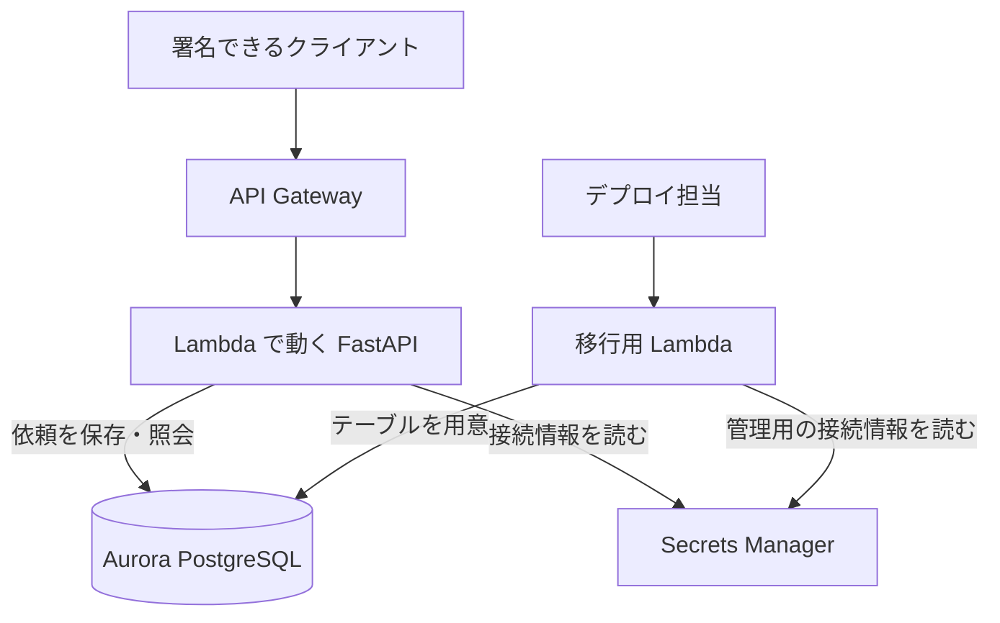

# API Gateway、Lambda、Aurora をつなぐ

修理依頼を受け付ける FastAPI ができました。次は、社員が同じ台帳を使えるように、API とデータベースを AWS に配置します。登録先のパスとレスポンスはローカル環境と同じです。ここで用意するのは、利用者が API を呼ぶ入口、アプリがデータを保存する経路、台帳を更新する手順です。

## 登録ボタンから台帳まで

`POST /repair-requests` を受け取る入口が **Amazon API Gateway** です。権限の確認を通ると、**AWS Lambda** がリクエストを受けて Python の関数を実行します。関数は **Amazon Aurora PostgreSQL** に件名と場所を保存し、受付番号を返します。



登録が済むと `201 Created` と `Location` が返ります。続けてそのパスに署名付きの `GET` を送れば、今登録した依頼を開けます。

## API Gateway と Lambda をつなぐ

このサンプルは API Gateway の **HTTP API** を使います。Python CDK の次の2行で、入口が確認する権限と、処理を任せる関数を指定します。

```python
default_authorizer=authorizers.HttpIamAuthorizer(),
default_integration=integrations.HttpLambdaIntegration("FastAPI", api_handler),
```

1行目で選ぶ **IAM** は AWS の権限管理の仕組みです。サンプルでは、開発者や CI が一時的な AWS 認証情報でリクエストに署名します。API Gateway は署名と `execute-api:Invoke` 権限を確認します。共有台帳の動作を少ない設定で検証するため、この構成を選びました。

2行目は `$default` ルートに届いたリクエストを API 用 Lambda に渡します。CDK は Gateway が関数を呼ぶ許可も設定します。Lambda の入口 `package.app.main.handler` では Mangum がイベントを FastAPI に渡し、FastAPI がメソッドとパスに対応する処理を選びます。公開先は `$default` ステージなので、利用者は URL にステージ名を足さずに呼べます。

<details>
<summary>追加の構成例　社員がスマートフォンから使う場合</summary>

社員が会社のログイン基盤でサインインする場合、画面はアクセストークンを API に送ります。API Gateway の JWT オーソライザーはトークンの署名、発行元、有効期限などを検証し、確認した情報を Lambda に渡します。アプリは発行元と利用者 ID から社員を特定し、社員台帳の所属や保存済みの依頼者と照合して、閲覧・変更を許可します。

</details>

## Lambda と Aurora をつなぐ

| 必要な設定 | このサンプルでの役割 |
| --- | --- |
| 通信経路 | Lambda と Aurora を同じ VPC（仮想ネットワーク）の隔離サブネットに置く。Aurora のセキュリティグループで、Lambda からの TCP 5432 を許す |
| 接続情報 | Lambda は VPC エンドポイント経由で Secrets Manager に接続する。TCP 443 の通信と、API 用シークレットを読む IAM 権限を与える |
| DB の接続先と権限 | `DB_HOST` と `DB_NAME` で接続先を指定する。`sslmode=verify-full` で証明書とホスト名を確認し、`repair_api` に許可した範囲でテーブルを読み書きする |

データベースを作っただけでは、修理依頼を入れるテーブルはまだありません。デプロイ後に移行用 Lambda を呼ぶと、Alembic が未適用のテーブル変更を行い、続いて移行用 Lambda が API 用の DB ユーザーに権限を与えます。日々の登録と照会に使う DB ユーザーには、データを読み書きするための権限だけを与えます。

## 構成を確かめ、台帳を使える状態にする

構成は Python のコードで定義し、同じ設定を繰り返し適用できるようにします。このサンプルでは、GitHub Actions が次の順で確かめます。

| 段階 | 何を確かめるか | どこで結果を読むか |
| --- | --- | --- |
| AWS に配置する前 | `cdk synth` で CloudFormation のテンプレートを生成する。配布するイメージもビルドし、その中で API 用と移行用の関数を読み込めることを確かめる | CI の `Verify sample` |
| AWS へ配置するとき | 検証済みのコミットから `cdk deploy` でスタックを適用し、移行用 Lambda を呼ぶ。新規環境ならテーブルを作り、更新時は未適用の変更を反映する | CD の `Deploy to AWS` と移行結果 |
| 配置後 | 公開 URL に署名なしで一覧を要求すると `403`。署名付きなら `limit=1` で `200`、`limit=0` で `422`。一覧が空でも応答の形式まで照合する | CD が保存する `aws-smoke-report` |

CD はデプロイ先を設定すると実行されます。署名付きの一覧取得が通れば、その時点で入口から Aurora まで読み取れたと分かります。登録・更新・削除の動作は、テスト専用の台帳で確かめます。[構築手順と実行結果の読み方](../../package/infra/README.md)・[API のテスト](testing.md)

運用担当には、公開 URL とデプロイ結果に加え、調査に使うログの場所を伝えます。修理依頼の処理を調べるなら API 用 Lambda、テーブル定義の変更を調べるなら移行用 Lambda の実行ログを開きます。サンプルはそれぞれのログを CloudWatch Logs に7日間保存します。受付が遅いときは、入口の応答時間を手掛かりに調査を始めます。[運用と監視の手順](operations.md)

<details>
<summary>追加の構成例　コマンドでは通るのに、別の Web 画面からだけ登録できない</summary>

画面が `https://staff.example.com`、API が `https://api.example.com` なら、別のオリジンです。どのオリジンの画面にレスポンスを読ませるかをブラウザーに伝える仕組みを **CORS** と呼びます。ブラウザーのネットワーク表示で、登録に先立つ `OPTIONS` のレスポンスを確認します。HTTP API 側で画面のオリジン、使うメソッド、送信するヘッダーを許可し、画面で登録先を読むには `Location` を公開するヘッダーに加えます。

教材のように `$default` ルートに IAM 認可がある場合は、事前確認用に認可を求めない `OPTIONS /{proxy+}` ルートと統合先を用意します。登録を行う `POST` には引き続き認可を適用します。

</details>

## 根拠と参考

- **入口と認可**　[AWS の IAM 認可](https://docs.aws.amazon.com/apigateway/latest/developerguide/http-api-access-control-iam.html)・[JWT オーソライザー](https://docs.aws.amazon.com/apigateway/latest/developerguide/http-api-jwt-authorizer.html)・[HTTP API の CORS 設定](https://docs.aws.amazon.com/apigateway/latest/developerguide/http-api-cors.html)
- **関数へ渡す方法**　[Lambda プロキシ統合とイベント形式](https://docs.aws.amazon.com/apigateway/latest/developerguide/http-api-develop-integrations-lambda.html)・[API Gateway が Lambda を呼ぶ許可](https://docs.aws.amazon.com/lambda/latest/dg/services-apigateway.html#services-apigateway-permissions)
- **保存先への接続**　[Lambda の VPC 接続](https://docs.aws.amazon.com/lambda/latest/dg/configuration-vpc.html)・[Secrets Manager の VPC 接続](https://docs.aws.amazon.com/secretsmanager/latest/userguide/vpc-endpoint-overview.html)・[Aurora の TLS](https://docs.aws.amazon.com/ja_jp/AmazonRDS/latest/AuroraUserGuide/AuroraPostgreSQL.Security.html)
- **配置と記録**　[CDK の合成とデプロイ](https://docs.aws.amazon.com/cdk/v2/guide/deploy.html)・[Lambda のロググループ](https://docs.aws.amazon.com/lambda/latest/dg/monitoring-cloudwatchlogs-loggroups.html)
- [CDK の実装](../../package/infra/app.py)・[接続コード](../../package/app/database.py)・[デプロイ手順と疎通確認](../../package/infra/README.md)

[FastAPI の実装](fastapi.md) ｜ [配信先の運用](operations.md) ｜ [教材の目次](../../README.md)
