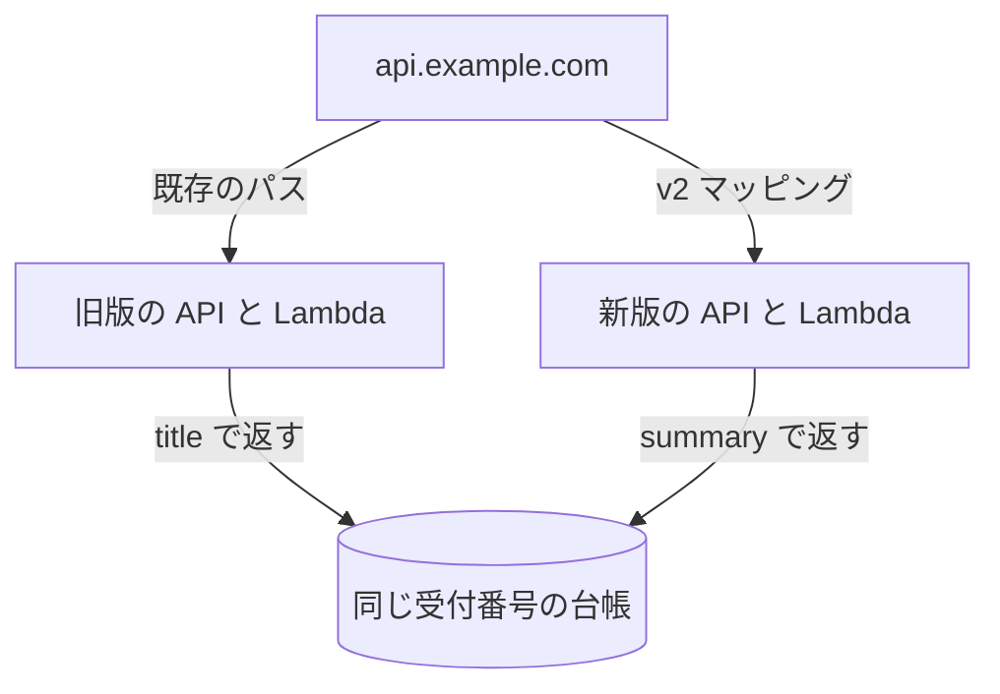

# 旧版と新版を並行稼働させる

修理依頼のサンプルは現在1つの版で動いています。次の手順は、2つの版を同時に公開する場合の構成例です。件名を `title` から `summary` に改名します。新旧の画面はしばらく同じ台帳を使います。公開パス、実装、データの3つをそろえると、どちらの画面も自分の知っている項目名で同じ依頼を読めます。

## 利用者が呼ぶ URL から転送先を決める

| HTTP API の入口 | 公開 URL の例 | 何が決まるか |
| --- | --- | --- |
| AWS 標準ドメインと `$default` ステージ（現行サンプル） | `https://{api-id}.execute-api.{region}.amazonaws.com/repair-requests` | ステージ名を足さずに今の API を呼ぶ |
| AWS 標準ドメインと名前付きステージ `prod` | `https://{api-id}.execute-api.{region}.amazonaws.com/prod/repair-requests` | `prod` に公開した設定を使う |
| カスタムドメインと API マッピング `v2` | `https://api.example.com/v2/repair-requests` | Gateway が `v2` で転送先の API とステージを選ぶ |

この構成例ではカスタムドメインに証明書と DNS を用意し、マッピングが空の入口を旧 API に、`v2` を新 API に向けます。Gateway がマッピングの部分を取り除くので、新 API 内で処理するパスは `/repair-requests` です。AWS 標準ドメインを既に案内している相手には、元の URL と API ID も残します。

小さなアプリなら、一つの FastAPI に両方のルートを持たせる構成も取れます。いずれの場合も、同じ公開 URL には毎回同じ契約のレスポンスを返します。ステージ名を分けた場合も、それぞれがどの Lambda と DB を使うかを確認します。

## 新版を出してから旧版を閉じるまで

1. **先に旧版を保護する。** 旧版の仕様書と契約テストを保存します。共有 DB に列が必要なら、旧実装でも読み書きできる変更を先に適用します。この教材の CD はスタック更新の後でマイグレーションを実行するため、新しい列を必要とするコードは、列を用意した後のリリースで配信します。
2. **両方の入口で試す。** 旧版で登録した依頼を新版で読み、新版で更新した依頼を旧版で読みます。新版の登録レスポンスの `Location` が `/v2/repair-requests/42` なら、そのまま `GET` して新版の件名が返ることも確かめます。`Location: /repair-requests/42` のままではホスト直下の旧版を呼びます。新 API の呼び出し権限も確認します。
3. **利用者ごとに切り替える。** 移行例と終了予定日を案内し、動作確認が済んだ利用者から新版に切り替えます。版ごとの呼び出し数・エラー率と、利用元からの移行報告を照合します。アクセスログを使う場合は、公開先を見分ける項目を配信前に設定します。サンプルに追加する設定は[運用と監視の手順](operations.md)で扱います。
4. **利用が終わったら閉じる。** 月次バッチのように間隔が長い呼び出しも含めて移行を確認します。旧版専用の DB 列を取り除くのは、切り戻しが必要な期間を過ぎてからです。

発展　カナリア配信、切り戻し、終了日の伝え方

同じ契約を保つ実装変更なら、Lambda の加重エイリアスで少数のリクエストだけを新しい関数へ送る**カナリア配信**ができます。今回の改名では旧画面が `title` を必要とするので、送るたびに旧版か新版かが変わると画面が壊れます。メジャー版の移行には利用者が選べる別の入口を用意します。

手動デプロイのステージなら、保持していた以前のデプロイメントに向け直せます。自動デプロイ中は `DeploymentId` を直接指定できません。Gateway の設定を戻した後も、関数と DB が旧版の契約を満たせるよう、配信前に戻し方を決めます。

終了の案内には、非推奨となる日を示す `Deprecation`、終了予定を示す `Sunset`、移行手順への `Link` も使えます。利用者がそのヘッダーを読めることと、事前に合意した連絡方法の両方を確かめます。

## 根拠と参考

- [AWS　HTTP API のステージ](https://docs.aws.amazon.com/apigateway/latest/developerguide/http-api-stages.html)・[カスタムドメインと API マッピング](https://docs.aws.amazon.com/apigateway/latest/developerguide/http-api-mappings.html)・[HTTP API のアクセスログ](https://docs.aws.amazon.com/apigateway/latest/developerguide/http-api-logging.html)
- [AWS　切り戻せる変更の進め方](https://aws.amazon.com/builders-library/ensuring-rollback-safety-during-deployments/)・[Lambda の加重エイリアス](https://docs.aws.amazon.com/lambda/latest/dg/configuring-alias-routing.html)・[ステージの AutoDeploy と DeploymentId](https://docs.aws.amazon.com/AWSCloudFormation/latest/TemplateReference/aws-resource-apigatewayv2-stage.html)
- [RFC 9110 §10.2.2　Location](https://www.rfc-editor.org/rfc/rfc9110.html#section-10.2.2)・[RFC 9745　非推奨の通知](https://www.rfc-editor.org/rfc/rfc9745.html)・[RFC 8594　終了予定の通知](https://www.rfc-editor.org/rfc/rfc8594.html)
- [サンプルの CD と疎通確認](../../package/infra/README.md)

[互換性の判断](../textbook/08-compatibility.md) ｜ [修理依頼の変更例](../examples/08-compatibility.md) ｜ [教材の目次](../../README.md)
