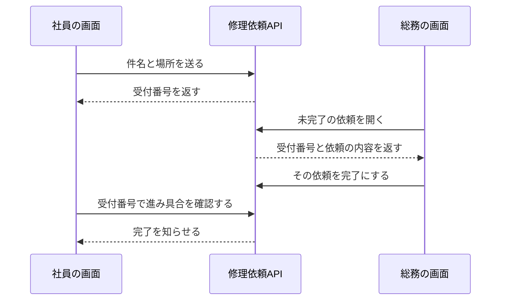

# 実例編 01　修理を依頼したその場で受付番号を返す

[教科書 01　API と HTTP](../textbook/01-http.md) ｜ [設計シート A1　利用者の行動](../templates/contract-sheet.md#scope)

## 要望と決めること

第2会議室の椅子がぐらついています。社員はその場で修理を依頼し、部屋を出る前に受け付けてもらえたかを知りたいと考えています。最初に決めるのは、誰が、いつ、どんな結果を必要とするかです。


## 選択肢と選んだ理由

夕方に依頼をファイルにまとめれば、本部は一日の仕事をまとめて取り込めます。今回の社員が必要とするのは、目の前の依頼が台帳に載ったという返事です。そこで画面から件名と場所を1件ずつ API に送り、保存が済んだら受付番号を返します。

同じ番号を社員と総務が使えば、総務が修理を終えた後、社員は受付に問い合わせずに進み具合を確かめられます。次の図は、二つの画面を作るときに API が担う役割を示します。



## 条件が変わったら

支店から本部に翌朝の作業予定を渡すだけなら、夕方にファイルを一つ送る方法も合います。この場合は、どの行を取り込めたかが分かる結果表を返すと、支店は失敗した行を直せます。

## 設計シートの記入結果

| 利用者 | 行動 | 必要な結果 |
| --- | --- | --- |
| 社員 | 故障に気付いたときに修理を依頼する | その場で受付番号を受け取れる |
| 総務 | 未完了の依頼を見つけて修理を終える | 同じ台帳の状態を完了に変えられる |
| 社員 | 翌日、受付番号で依頼を開く | 総務が更新した状態を読める |

<details>
<summary>手元で確かめる（任意）　curl で受付番号を確かめる</summary>


[手元で API を起動](../build/fastapi.md)したら、次の1行を UTF-8 のファイル `repair.json` に保存します。

```json
{"title":"椅子がぐらつく","location":"第2会議室"}
```

保存したフォルダーで次のコマンドを1回実行します。Windows の PowerShell では、各コマンドの先頭を `curl.exe` に替えてください。この書き方は、後の章でも同じです。

```console
curl -i -H "Content-Type: application/json" --data-binary "@repair.json" "http://127.0.0.1:8000/repair-requests"
```

返事の先頭に `201 Created`、その下の `location` に取得先が表示されます。たとえば `/repair-requests/42` なら受付番号は42番です。実際に返った番号を控えて[実例 02](02-resources.md)に進みます。

</details>

[教科書 01](../textbook/01-http.md) ｜ [実装 01](../implementation/01-http.md) ｜ [シート A1](../templates/contract-sheet.md#a1) ｜ [次へ　第2章](02-resources.md) ｜ [目次](../../README.md)
