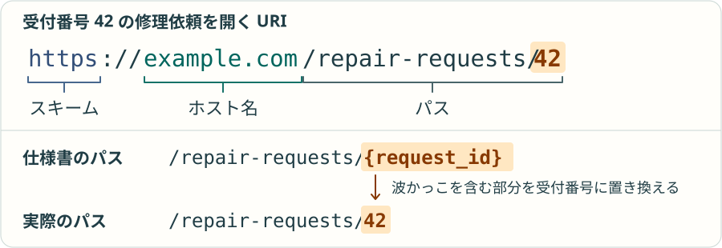

# 実例編 03　受付番号、一覧の条件、登録内容を分ける

[教科書 03　パスと入力の選び方](../textbook/03-inputs.md) ｜ [設計シート B3　入力の置き場所](../templates/contract-sheet.md#operation)

## 要望と決めること

社員は受付番号で1件を開き、総務は未完了の依頼を最大10件ずつ読みます。どちらにも数字が登場しますが、「42番」の42を替えると対象の依頼が変わり、「最大10件」の10を替えると同じ一覧の読み方が変わります。

## 選択肢と選んだ理由

台帳全体の宛先を `/repair-requests` とします。受付番号は対象の一部なので、その後ろに置きます。仕様書の `{request_id}` は実際に送るときに受付番号に替えます。



一覧に未完了と完了のパスを別々に作る案もあります。総務が切り替えたいのは、同じ台帳の表示条件です。そこで一覧のパスを一つにして、`?status=open&limit=10` を付けます。条件に合う依頼がなくても、その一覧を開けたことを示す空の `items` を返します。

同じ `status` でも、**未完了の依頼を探す値**はクエリに、**この依頼を完了にする値**は更新する本文に置きます。登録時の件名と場所も本文です。新しい受付番号と初期状態を決めるのは受付側なので、利用者が登録時の本文に入れるのは件名と場所の二つです。[公開仕様書](../openapi.yaml)

## 条件が変わったら

修理ごとに複数の作業記録を残すなら、番号の付け方で宛先も変わります。作業記録を依頼ごとに1から数えるなら `/repair-requests/42/work-logs/3` で1件が決まります。会社全体で一意な作業番号を発行するなら `/work-logs/3` だけでも対象を特定できます。

## 設計シートの記入結果

| 渡すもの | 記入する置き場所と条件 |
| --- | --- |
| 1件の受付番号 | パス `/repair-requests/{request_id}` |
| 一覧の状態・件数・続き | クエリ `status`、`limit`、`after`。受付番号順に返す。続きがあれば `next_after` を次の `after` に使う |
| 件名・場所 | 登録の本文 `title` と `location`。API が `id` を採番する |
| 本文の形式 | ヘッダー `Content-Type: application/json` |

<details>
<summary>手元で確かめる（任意）　一覧の読み方を変える</summary>


[手元で API を起動](../build/fastapi.md)し、次のリクエストを順に送ります。Windows の PowerShell では `curl.exe` を使います。

```console
curl -i "http://127.0.0.1:8000/repair-requests?status=open&limit=1"
curl -i "http://127.0.0.1:8000/repair-requests?status=completed&limit=1"
```

どちらも `200` と一覧が返ります。受付直後の依頼は未完了なので、完了一覧には現れません。次は[実例 04](04-methods.md)で、この依頼を完了にします。

</details>

[前へ　第2章](02-resources.md) ｜ [教科書 03](../textbook/03-inputs.md) ｜ [シート B3](../templates/contract-sheet.md#b3) ｜ [次へ　第4章](04-methods.md) ｜ [目次](../../README.md)
