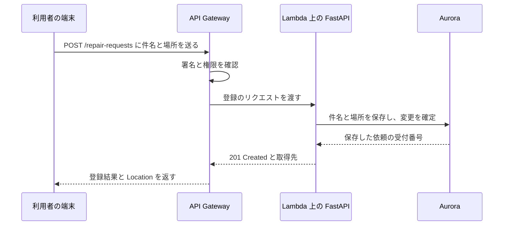
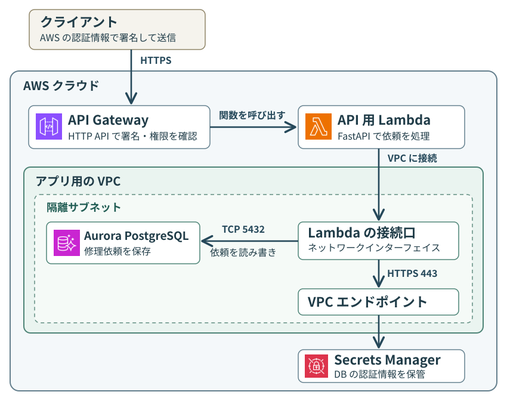

# クラウドとは何か　修理依頼で見る AWS の構成

社員が「第2会議室の椅子がぐらつく」と知らせ、総務が別の端末からその依頼を開きます。二人が同じ受付番号で同じ依頼を見るには、どちらの端末からも呼び出せるアプリと、依頼を保存しておく共通の台帳が必要です。

**クラウド**とは、アプリを動かすコンピューターやデータの保存先などを、必要に応じてネットワーク越しに利用できる仕組みです。ここでは **Amazon Web Services（AWS）** というクラウドを使います。どの部品に何を任せ、どうつなぐかを表したものが、このアプリの**アーキテクチャ（システム構成）**です。

## 入口、処理、保存を誰が受け持つか

| 必要な役割 | このサンプルで使うもの | 修理依頼を1件登録するとき |
| --- | --- | --- |
| ネットワークからの呼び出しを受ける | **Amazon API Gateway**。API の公開 URL を用意するサービス | 呼び出し元の署名と権限を確かめ、依頼を処理するプログラムへ渡す |
| プログラムを動かす | **AWS Lambda**。呼び出しに応じてコードを実行するサービス | Lambda 上で **FastAPI** が動く。FastAPI は Python で Web API を書くためのライブラリで、メソッドとパスを見て登録用の関数を選ぶ |
| 台帳を保存する | **Amazon Aurora PostgreSQL**。表の形でデータを保存するデータベース（DB） | 件名・場所・状態を1行に保存し、受付番号を付ける。後日もその番号で読み直せる |

「件名と場所を送ると受付番号が返る」という利用者との取り決めが **API** です。その取り決めを使えるように公開 URL で呼び出しを受けるのが **API Gateway** です。

## 1件登録すると何が返るか

件名と場所を送ってから受付番号が返るまでを、上から順に読みます。`POST` は、この API では新しい依頼の登録を頼むときに使う HTTP メソッドです。図の「利用者の端末」では、プログラムが AWS の認証情報を使ってリクエストに署名します。API Gateway はその署名を検証し、呼び出し元にこの API を使う権限があるかを確認します。

たとえば端末に `201 Created` と `Location: /repair-requests/42` が返れば、42番で登録できました。総務がその宛先に `GET` を送ると、同じ入口を通り、今度は FastAPI が詳細取得の関数を選びます。Aurora に保存した42番の依頼が返ります。[登録と詳細取得のコード](../../package/app/main.py)

## AWS 上で部品はどうつながるか

上のやり取りを、今度は配置で見ます。図の **VPC** は、このアプリ用に用意した AWS 上の専用ネットワークです。まず、端末から API Gateway、API 用 Lambda、Aurora までの線をたどってください。

サービスアイコン © Amazon Web Services, Inc. or its affiliates. [AWS Icons for PlantUML v23.1](https://github.com/awslabs/aws-icons-for-plantuml/tree/v23.1)・[CC BY-ND 2.0](https://creativecommons.org/licenses/by-nd/2.0/)

- **受付から処理へ**　API Gateway が呼ぶのは API 用の Lambda です。公開 URL を受け持つのは API Gateway、件名や場所を検査して保存処理を選ぶのは FastAPI です。
- **処理から台帳へ**　Lambda は VPC に接続し、外部に公開していない Aurora にアクセスします。図の `5432` は PostgreSQL への接続に使うポート番号です。
- **DB に接続するとき**　DB のユーザー名とパスワードは **AWS Secrets Manager** に保管します。Lambda は VPC 内の専用の接続口（VPC エンドポイント）を通って認証情報を読みます。図の `443` はこの HTTPS 通信に使うポート番号です。[DB の接続処理](../../package/app/database.py)・[AWS 側の構成を定義するコード](../../package/infra/app.py)

日々の登録に先立って、台帳の表を用意する仕事もあります。デプロイ時には別の移行用 Lambda がその仕事を担当します。2つの関数の設定と実行順は [AWS の構築ガイド](../build/aws.md)で確認できます。

## 次に試すこと

手元で同じ登録や照会を試すときは、自分の端末でアプリを動かし、台帳を SQLite のファイルに保存できます。AWS のアカウントを準備する前に、[実装編 01 の手順](01-http.md)で一覧を開いてみてください。

**公式資料**　[クラウドコンピューティングとは](https://aws.amazon.com/jp/what-is-cloud-computing/)・[API Gateway の HTTP API](https://docs.aws.amazon.com/ja_jp/apigateway/latest/developerguide/http-api.html)・[Lambda とは](https://docs.aws.amazon.com/ja_jp/lambda/latest/dg/welcome.html)・[Aurora とは](https://docs.aws.amazon.com/ja_jp/AmazonRDS/latest/AuroraUserGuide/CHAP_AuroraOverview.html)・[Lambda の VPC 接続](https://docs.aws.amazon.com/ja_jp/lambda/latest/dg/configuration-vpc.html)・[Secrets Manager の VPC エンドポイント](https://docs.aws.amazon.com/ja_jp/secretsmanager/latest/userguide/vpc-endpoint-overview.html)

[実装編の目次](README.md) ｜ [教材の目次](../../README.md)
