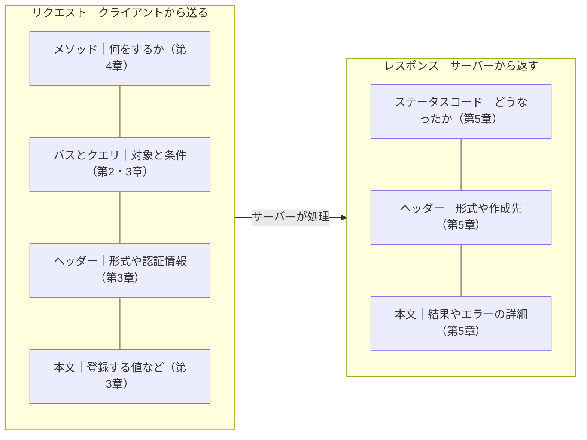

# 第1章　API と HTTP の全体像

設計シートの A1「利用者の行動」を書き、B1「目的」に使う操作を一つ選びます。利用者が一つの操作を終えたと分かる瞬間まで、普段の業務の言葉で書きます。

## 定義

**API**（Application Programming Interface）は、あるプログラムの機能を、ほかのプログラムから使うための取り決めです。何を頼めるか、何を渡すか、どんな結果を受け取るかを決めます。同じ取り決めを複数の画面や自動処理から使えるので、それぞれに同じ業務処理を作る手間が減ります。

この教材が扱う **Web API** は、ネットワーク越しに呼び出せる API です。呼び出すプログラムを**クライアント**、受け付ける側を**サーバー**と呼びます。

両者がメッセージをやり取りする規則が **HTTP** です。クライアントが送る依頼が**リクエスト**、サーバーが返す結果が**レスポンス**です。

## HTTP の部品

図の左が送る内容、右が返る内容です。括弧の章で、その部品に何を書くかを決めます。

**パス**は対象を示す道筋、**クエリ**は宛先の末尾に添える条件です。**ヘッダー**はメッセージをどう扱うかを伝え、**本文**は必要なときにデータを運びます。よく使う本文の形式が **JSON** です。たとえば `{"count":3}` は、項目 `count` の値が数値の3であることを表します。

## 選ぶ基準

相手が「いつ」「どの単位で」結果を必要とするかを先に確かめます。

| 必要な結果 | 向いている連携の例 | 最初に取り決めること |
| --- | --- | --- |
| 次の操作に進む前に、1件の受付結果を知りたい | その場で API を呼ぶ | 何を受け取れば受付済みと分かるか |
| 締め時刻までの全件を、相手の都合で取り込みたい | 一定期間ごとにファイルを渡す | 対象期間、受け渡したファイルの識別方法、取り込みに失敗した行の通知方法 |

API でも一括受付ができ、ファイルも到着直後に処理できます。受け付けてから完了まで時間がかかるなら、受付をいつ知らせ、完了をどこで確かめるかを別々に決めます。

## よくある誤り

「登録ボタンを用意する」だけでは、押した後に何を確認できればよいかが伝わりません。「利用者が1件を登録し、返った番号であとから開ける」のように、結果を確かめるところまで書くと、画面と API の担当者が同じ条件で判断できます。

## 設計の進め方

1. **行動を一つ選ぶ。** 誰が、何をしたいか、何ができれば完了かを一行にする。
2. **対象を選んで、宛先を付ける。** 何を1件と数え、同じ1件をあとからどう指定するかを決める（第2章）。
3. **入力の置き場所を選ぶ。** 対象を示す値、一覧の条件、保存する値、通信に必要な情報を振り分ける（第3章）。
4. **操作と結果を決める。** 求める変化に合うメソッドと、成功・失敗を伝えるレスポンスを選ぶ（第4・5章）。
5. **一つの契約にまとめる。** 権限、入力の境界、失敗や再送で何が残るかを加え、設計シートに戻って確認する（第6章）。
6. **仕様書として共有する。** OpenAPI という書式に写し、入力例から結果を予測する。公開済みの API を変えるときは、従来の使い方も確かめる（第7・8章）。

## 根拠と参考

- [MDN「API」](https://developer.mozilla.org/ja/docs/Glossary/API)・[RFC 9110 §3.3–3.4 呼び出す側と受ける側](https://www.rfc-editor.org/rfc/rfc9110.html#section-3.3)・[§6 HTTP メッセージ](https://www.rfc-editor.org/rfc/rfc9110.html#section-6)
- [RFC 8259 §4 JSON オブジェクト](https://www.rfc-editor.org/rfc/rfc8259.html#section-4)・[Hohpe・Woolf『Enterprise Integration Patterns』File Transfer](https://www.enterpriseintegrationpatterns.com/patterns/messaging/FileTransferIntegration.html)

[実例 01](../examples/01-http.md) ｜ [シート A1](../templates/contract-sheet.md#a1) ｜ [次へ　第2章](02-resources.md) ｜ [目次](../../README.md)
